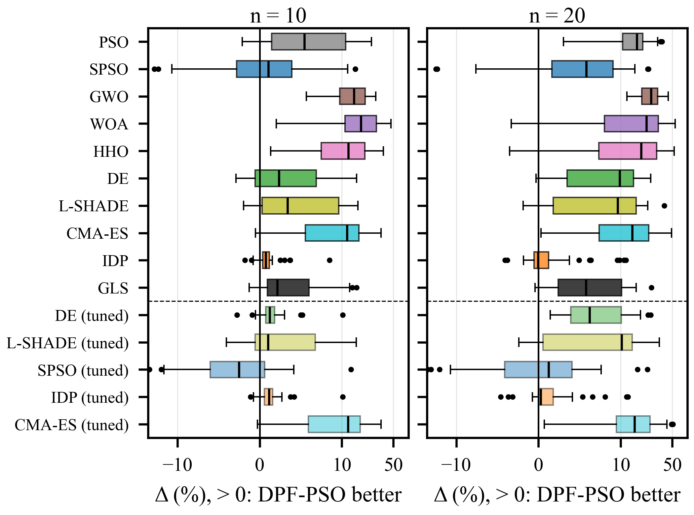
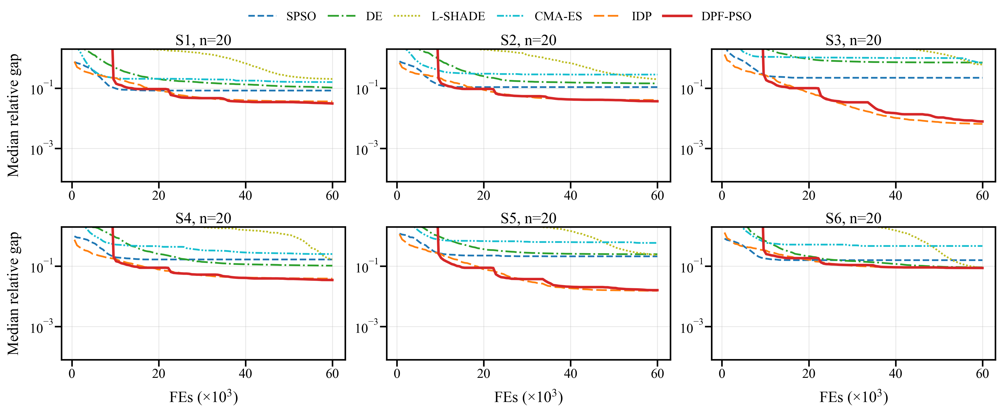

::: {custom-style="ArticleType"}
Article
:::

::: {custom-style="Title"}
Dynamic-Programming Path Fusion: An Optimal Recombination Operator for Swarm Optimizers in 3-D UAV Path Planning
:::

::: {custom-style="Author"}
[Author Name]^1,\*^
:::

::: {custom-style="Affiliation"}
^1^ School of Artificial Intelligence, Beijing University of Posts and Telecommunications, Beijing 100876, China

\* Correspondence: [email]
:::

::: {custom-style="Highlights"}
**Highlights**
:::

::: {custom-style="HighlightQuestion"}
**What are the main findings?**
:::

::: {custom-style="HighlightBullet"}
A dynamic-programming recombination operator (DPF) that returns the least-cost path assemblable from a swarm's memory makes PSO significantly better than all black-box metaheuristics with the same waypoint encoding and than a one-shot lattice DP on 40 held-out UAV scenarios, at equal evaluation budgets.

Iterative dynamic programming comes within about one percent of DPF-PSO: most of the gain comes from exploiting the cost structure, and at equal CPU time the advantage over spherical-vector PSO is not significant.
:::

::: {custom-style="HighlightQuestion"}
**What are the implications of the main findings?**
:::

::: {custom-style="HighlightBullet"}
Comparisons of new UAV path planners against black-box metaheuristics alone overstate their benefit for this cost model; structure-exploiting baselines and equal-CPU-time comparisons should be standard.

How a constraint is checked (the altitude band at waypoints only) can decide the ranking of planners; the finding was confirmed by a pre-registered test on 40 further scenarios.
:::

::: {custom-style="Abstract"}
**Abstract:** Swarm optimizers for three-dimensional (3-D) path planning of unmanned aerial vehicles (UAVs) usually treat the path cost as a black box, although the widely used cost model of Phung and Ha is a sum of terms that each involve at most three consecutive waypoints. We exploit this structure with dynamic-programming path fusion (DPF), an optimal recombination operator that returns, in $O(nK^3)$ time, the least-cost path that can be assembled from $K$ candidate positions per waypoint taken from the swarm memory, perturbations and random samples; embedded in particle swarm optimization, it gives DPF-PSO. On 40 held-out scenarios with exact ground clearance and equal evaluation budgets, DPF-PSO had significantly lower median costs than all black-box metaheuristics with the same waypoint encoding, including DE, L-SHADE and CMA-ES (gaps of 2.3%–18.2% for 10 and 9.6%–25.8% for 20 waypoints), and than a one-shot lattice dynamic program. Iterative dynamic programming came within 1.1%, so most of the gain comes from exploiting the cost structure. The advantage is partly one of speed: with five times the budget the black-box methods closed much of the gap, and at equal CPU time DPF-PSO was not significantly better than spherical-vector PSO. Tuned spherical-vector PSO was better for 10 waypoints; its paths left the altitude band between waypoints, where the model does not check it, and with the band enforced along the path tuned DPF-PSO was significantly better for both numbers of waypoints, a result confirmed by a pre-registered test on 40 further scenarios. As a plug-in, DPF lowered the median cost of six host algorithms by 9.8%–23.1% on average.
:::

::: {custom-style="Keywords"}
**Keywords:** UAV path planning; particle swarm optimization; dynamic programming; optimal recombination; gray-box optimization; benchmarking
:::

# 1. Introduction

Path planning lets an unmanned aerial vehicle (UAV) reach its goal while avoiding terrain and threats and respecting its flight limits [1], [2]. In 3-D environments with continuous waypoint coordinates, the problem is usually written as the minimization of a weighted cost over a fixed number of waypoints and solved with population-based metaheuristics, which cope with the non-convex landscape created by obstacles [3]. Particle swarm optimization (PSO) [4] and its variants are among the most used methods, from phase-angle-encoded quantum-behaved PSO [5] to spherical-vector PSO (SPSO) [6], which encodes each segment by its length, elevation and azimuth, and its recent extensions [7]. New metaheuristics are regularly evaluated on this problem [8]–[11], although the value of many metaphor-based designs has been questioned [12], [13].

Most of these methods treat the path cost as a black box, although the cost model of [6], variants of which are used in later work [7], is a sum of terms that depend on one waypoint (altitude), two consecutive waypoints (length, threats, clearance) or three (turning and climbing angles). Gray-box optimization exploits such structure inside evolutionary search [14]; partition crossover, for example, returns the best of exponentially many offspring in linear time [15], [16]. Recombination that returns the best offspring that can be assembled from the parents' genes is called optimal or dynastically optimal recombination [17], [18], and recombination from the whole population gene-pool recombination [19]. Dynamic programming over candidate sets with a three-point term is classical for active contours [20]; driving planners select paths on lattices in station–lateral (Frenet) coordinates by dynamic programming [21], [22]; and iterative dynamic programming solves dynamic programs over candidates sampled in a shrinking region around the current best [23]. We combine these ideas in a different setting: the candidate sets come from the memory of a continuous population-based optimizer, the dynamic program is a plug-in recombination operator, and structure-exploiting competitors separate the effect of the swarm from that of the dynamic program.

A second theme of this paper is how such a method should be evaluated. Comparisons of new metaheuristics on this problem are usually made against other black-box metaheuristics only, on a handful of scenarios that were also used while the method was designed. We instead fix the method on four design scenarios, test it on 40 held-out scenarios from a generator with a fresh seed family, compare it with structure-exploiting baselines at equal evaluation budgets, equal tuning budgets and equal CPU time, and, for the one finding that was made after the held-out results were known, we wrote the test down before running it on 40 further scenarios.

This paper makes four contributions:

1\. Dynamic-programming path fusion (DPF), an optimal recombination operator for waypoint-based path encodings. Given candidate positions for each waypoint, taken from the swarm memory, from perturbations and from random samples, DPF returns in $O(nK^3)$ time the least-cost path that can be assembled from them; the result is never worse than any parent, and an exact pruning rule reduces the computation.

2\. DPF-PSO and a plug-in interface for population-based optimizers that use the same slot encoding. With DPF, six different swarm and evolutionary hosts reached nearly the same path costs on the benchmark scenarios.

3\. An evaluation on 40 held-out scenarios and the public scenario of [6] with exact ground clearance, an independent safety check, equal tuning budgets and three structure-exploiting baselines, including a one-shot lattice dynamic program. It shows that exploiting the cost structure accounts for most of the improvement over black-box metaheuristics, so that comparisons with black-box methods alone overstate the benefit of new metaheuristics for this cost model, and it quantifies the price of the operator in CPU time.

4\. Evidence that the altitude band of the model, checked only at waypoints, favours encodings that can merge waypoints, confirmed on 40 further held-out scenarios by a pre-registered test. The finding shows that how constraints are checked can decide the ranking of planners.

The rest of the paper is organized as follows. Section 2 reviews related work. Section 3 states the problem and the cost model, Section 4 the operator and DPF-PSO, Section 5 the experimental design, including which decisions were fixed before which results were known. Section 6 reports the results, Section 7 discusses them and Section 8 concludes.

# 2. Related Work

## 2.1. Metaheuristics for 3-D UAV Path Planning

Surveys of UAV path planning [1]–[3], [24], [25] list sampling-based, graph-based, optimal-control and metaheuristic approaches; for 3-D terrain-following flight with a fixed number of waypoints, population-based metaheuristics dominate the recent literature, among them grey wolf optimizers hybridized with reinforcement learning [26], constrained differential evolution for disaster scenarios [27] and many PSO variants [28], [29]. The cost model of Phung and Ha [6], which combines path length, threat proximity, altitude and smoothness, has become a common benchmark; SPSO, proposed with it, encodes each segment in spherical coordinates so that the path is built incrementally and feasibility is easier to maintain. Later work keeps the model and changes the optimizer: adaptive evolutionary SPSO [7], new nature-inspired algorithms [8], [9], hybrids of swarm search and reinforcement learning for multiple UAVs [10], and archive-guided mutation PSO [11]. Almost all of these methods evaluate the cost as a black box and compare against other black-box methods; the benchmark scenarios are usually the ones on which the method was developed.

## 2.2. Gray-Box Optimization and Optimal Recombination

When an objective function decomposes into low-order terms, evolutionary algorithms can use this structure. Gray-box optimization [14] exploits the variable interaction graph of Mk landscapes for constant-time neighbourhood evaluation and for recombination; partition crossover [15], [16] decomposes the parents' differences into independent components and returns the best of exponentially many offspring, and combined with local search it solves NK landscapes with a million variables [30]. Optimal recombination, also called dynastically optimal recombination [17], [18], asks for the best offspring that can be formed from the parents' genes and is tractable for several combinatorial problems; gene-pool recombination [19] draws genes from the whole population instead of from two parents. DPF is optimal recombination over the population memory of a continuous optimizer, made tractable by the chain structure of the path cost.

## 2.3. Dynamic Programming over Candidate Sets

Dynamic programming over per-node candidate sets with pairwise and triplewise terms was introduced for active contours in computer vision [20]. In motion planning for mobile robots and road vehicles, lattice planners discretize the state space into a regular lattice [31] or generate candidate positions in station–lateral (Frenet) coordinates and select a path through them by dynamic programming [21], [22]. Iterative dynamic programming [23] solves the same kind of dynamic program over candidates sampled around the incumbent in a region that shrinks over the iterations, and is used for optimal control. These methods fix the candidate sets by a lattice or by sampling; DPF takes them from the memory of a swarm, so that the candidates have already been shaped by the search, and returns the fused path to the swarm.

## 2.4. Evaluation Practice

Criticism of the metaheuristics literature [12], [13], [32] concerns both novelty claims and evaluation: comparisons on the development scenarios, against weak or untuned baselines, without structure-exploiting alternatives and without accounting for the cost of an evaluation; even on standard benchmark suites, results can be inflated by properties of the test functions that a method exploits without the authors noticing [33]. Benchmarking platforms for continuous optimizers [34] therefore report performance over the whole run rather than at a single budget, and guidelines for statistical comparison of swarm and evolutionary algorithms [35], [36] recommend non-parametric tests with corrections for multiple comparisons. We follow these recommendations and add one from the empirical sciences, pre-registration [37]: held-out test scenarios, equal tuning budgets, comparisons at equal CPU time as well as at equal evaluation counts, scenario-level statistics, and a confirmatory test, written down before it was run, of the one finding that was made after the results were known.

# 3. Problem Formulation

## 3.1. Environment and Path Representation

The workspace is a rectangular area with terrain elevation $Z(x,y)$ given on a grid of spacing $\delta$ with bilinear interpolation and $N_t$ vertical cylindrical threats with centres $\mathbf{c}_k$ and radii $R_k$. A path consists of the start $S$, waypoints $P_1,\dots,P_n$ and the goal $G$. Let $L$ be the horizontal distance between $S$ and $G$, $\mathbf{e}_1$ the horizontal unit vector from $S$ to $G$ and $\mathbf{e}_2$ its left normal. The segment $SG$ is divided into $n$ slots centred at $B_j=S+j\Delta s\,\mathbf{e}_1$ with $\Delta s=L/(n+1)$, and waypoint $j$ is placed at

$$P_j^{xy}=B_j+\tau_j\Delta s\,\mathbf{e}_1+u_j\mathbf{e}_2,\qquad z_j=Z(P_j^{xy})+h_j$$

with along-track offset $\tau_j\in[-0.45,0.45]$, height above ground $h_j\in[100,200]$ m and lateral offset $u_j\in[-400,400]$ m, narrowed so that $B_j+u_j\mathbf{e}_2$ stays inside the map; a point moved outside the map by $\tau_j$ is clipped to it. The decision vector $\mathbf{x}=(u_j,h_j,\tau_j)_{j=1}^{n}$ has $3n$ variables, as in SPSO. Because the slots do not overlap, waypoints stay ordered along $SG$; this is the station–lateral parametrization of lattice planners [21], [22], [31].

## 3.2. Cost Function and Exact Ground Clearance

We use a modified version of the cost model of Phung and Ha [6] with the weights of their public code, $b_1=5$, $b_2=1$, $b_3=10$, $b_4=1$:

$$J=b_1F_1+b_2F_2+b_3F_3+b_4F_4+\Pi$$

$F_1$ is the 3-D path length. $F_2=\sum_{j,k}\min\{S_d,(R_k+D+S_d-d_{jk})^+\}$ measures how deep segment $j$ enters the danger zone of width $S_d=10$ m around threat $k$, where $d_{jk}$ is the horizontal distance from $\mathbf{c}_k$ to the segment and $D=1$ m the UAV size. $F_3=\sum_j|h_j-150|$ penalizes deviations from the centre of the altitude band $[100,200]$ m, which, as in [6], applies at the waypoints. $F_4$ sums, over the waypoints, the turning angle between the horizontal projections of the two segments that meet there and the change of their climb angles, in degrees. The model differs from [6] in three respects. First, a violated element adds a finite penalty instead of an infinite cost: $M_0=10^5$ for every inflated threat radius $R_k+D$ a segment enters and once more if its minimum ground clearance $c_{\min}$ is below $h_c=20$ m, plus $\lambda=10^3$ times the penetration depths and the shortfall $(h_c-c_{\min})^+$. Second, the clearance is enforced exactly along every segment instead of at the waypoints only. Third, the angle terms are not thresholded; the public code of [6] counts an angle only above 45°, which makes the cost piecewise constant in the angles. As in that code, angles are measured between consecutive non-degenerate segments. The costs reported here are therefore not comparable with those of [6].

Inside a grid cell, the bilinear terrain along a segment is quadratic in the segment parameter and the segment altitude is linear, so the minimum clearance per cell has a closed form; pieces of a segment whose conservative bound already exceeds $h_c$ are skipped. The result agrees with an independent implementation to within $5\times10^{-13}$ m on 7,200 random segments (Supplementary Material S1). With $P_0=S$ and $P_{n+1}=G$, every term of $J$ involves at most three consecutive points:

$$J=\sum_{j=1}^{n}A(P_j)+\sum_{j=0}^{n}E(P_j,P_{j+1})+\sum_{j=1}^{n}T(P_{j-1},P_j,P_{j+1})$$

The altitude term $A$ holds $b_3F_3$, the edge term $E$ the length, danger and violation terms, and the turn term $T$ the smoothness terms. $E$ needs terrain and threat computations and dominates the cost of an evaluation; $T$ is cheap arithmetic.

# 4. Dynamic-Programming Path Fusion

## 4.1. Fusion Problem and Recursion

Assume that for every slot $j$ a finite set $C_j$ of $K_j$ candidate waypoints is given, with $C_0=\{S\}$, $C_{n+1}=\{G\}$ and $K_0=K_{n+1}=1$. The fusion problem asks for the least-cost path whose $j$-th waypoint belongs to $C_j$ for every $j$; exhaustive search would examine $\prod_jK_j$ paths ($10^{40}$ for $n=20$, $K_j=100$). Because $T$ couples three consecutive points, the state of the dynamic program is the pair of the last two waypoints. Let $W_j(q,r)$, $q\in C_{j-1}$, $r\in C_j$, be the least cost of a partial path ending with $q,r$, including all terms up to $r$ except the turn at $r$. Then $W_1(S,r)=E(S,r)+A(r)$ and, for $j=2,\dots,n+1$, with $p$ ranging over $C_{j-2}$,

$$W_j(q,r)=E(q,r)+A(r)+\min_p\big[W_{j-1}(p,q)+T(p,q,r)\big]$$

with $A(G)=0$; the optimal cost is $J^*=\min_qW_{n+1}(q,G)$, and the minimizing $p$ stored for every $(q,r)$ gives the path by backtracking (Figure 1).

*Remark 1.* $J^*$ is the least cost over all $\prod_jK_j$ assemblable paths and is not larger than the cost of any parent whose waypoints are in the candidate sets, because no term involves more than three consecutive points (principle of optimality [38]) and every parent is an assemblable path. DPF is therefore an optimal recombination operator in the sense of [17], [18], restricted to the candidate sets; it does not solve the continuous problem exactly.

{width=90mm}

## 4.2. Pruning, Cost Accounting and Pseudo-Code

Each angle in $F_4$ lies in $[0^\circ,180^\circ]$, so $0\le T\le T_{\max}=360\,b_4$. A predecessor $p$ with $W_{j-1}(p,q)>\min_{p'}W_{j-1}(p',q)+T_{\max}$ can never attain the minimum in (4) for any $r$ and is skipped (Algorithm 1, line 5). This pruning is exact; it returned bit-identical results in 324 random test cases and reduced the time of one fusion with $n=20$ and $K_j=100$ by a factor of 1.7. A fusion evaluates $\sum_jK_jK_{j+1}$ edge terms and $\sum_jK_{j-1}K_jK_{j+1}$ turn terms. Because edge terms dominate the cost of an evaluation, a fusion is charged $\lceil\sum_jK_jK_{j+1}/(n+1)\rceil$ function evaluations (FEs), the number of segments evaluated divided by the number of segments of one path; turn terms are not charged, and their cost appears in the CPU-time comparisons of Section 6.5.

| **Algorithm 1:** DPF$(C_1,\dots,C_n)$ |
|:--|
| 1: compute $A(r)$ for all candidates and $E(q,r)$ for consecutive slots |
| 2: $W_1(S,r)\leftarrow E(S,r)+A(r)$ for all $r\in C_1$ |
| 3: **for** $j=2,\dots,n+1$ **do** |
| 4:   **for** each $q\in C_{j-1}$: $m_q\leftarrow\min_pW_{j-1}(p,q)$ |
| 5:     $\Pi_q\leftarrow\{p: W_{j-1}(p,q)\le m_q+T_{\max}\}$ (exact pruning) |
| 6:     **for** each $r\in C_j$: $W_j(q,r)\leftarrow E(q,r)+A(r)+\min_{p\in\Pi_q}[W_{j-1}(p,q)+T(p,q,r)]$; store $\arg\min$ |
| 7: $J^*\leftarrow\min_qW_{n+1}(q,G)$; backtrack the stored predecessors |
| 8: **return** the fused path and $J^*$ |

## 4.3. Candidate Sets and DPF-PSO

*Global fusion* uses the $j$-th waypoints of the $N_g=50$ best distinct solutions in the population memory and of $N_r=50$ new uniform random solutions, which are not evaluated individually; it resembles the lattice of [22] with nodes supplied by the swarm. *Local fusion* uses the $N_e=5$ best solutions and $N_p=6$ Gaussian perturbations $\mathbf{x}^*+\sigma(\mathbf{x}_{\max}-\mathbf{x}_{\min})\odot\boldsymbol{\epsilon}$ of the best solution $\mathbf{x}^*$, clipped to the bounds; $\sigma$ starts at 0.05 and is multiplied by 1.5 after a successful local fusion and by 0.75 otherwise, within $[10^{-3},0.2]$. Duplicate solutions and, within a slot, duplicate waypoints are removed. DPF-PSO runs inertia-weight PSO [39] (50 particles, $c_1=c_2=2$, velocity limit 20% of the ranges, inertia weight decreasing linearly from 0.9 to 0.4 with the fraction of the budget used). It applies global fusion to the initial swarm and then, counted in host FEs (FEs not charged to fusion), global fusion every 5,000 and local fusion every 250 host FEs (every 100 and 5 iterations). A fused path that is cheaper than the best personal best replaces the worst one, and that particle is moved to it with zero velocity; a fusion that does not fit into the remaining budget is skipped.

## 4.4. Plug-In Interface

Any optimizer with a population memory and the slot encoding can use the operator with the same schedule: the host passes its population (and, where it has them, its leaders) to DPF, and an accepted fused path replaces the worst member. Section 6.2 reports DPF inside DE, L-SHADE, GWO, WOA and HHO in addition to PSO. SPSO cannot host DPF, because in its spherical encoding the $j$-th variable triple is not tied to slot $j$.

# 5. Experimental Design

## 5.1. Scenarios

S1–S6 (Table 1) are synthetic 1 km × 1 km scenarios with a 5 m terrain grid. S1–S4 were used to design DPF-PSO and are the only scenarios used for tuning; S5 and S6 were added after the design was fixed but were used in an earlier test. H01–H40 come from a procedural generator with a new seed family and were not used for any design or tuning decision (only H01 appeared in a two-run smoke test of the pipeline); they carry the confirmatory claims about DPF-PSO. H41–H80 come from the same generator with seeds that had never been used; they serve only the pre-registered test of Section 6.3. C1 is the public scenario of [6] (a real elevation model with 1 m pixels and six threats). Each scenario is solved with $n=10$ and $n=20$ waypoints (30 and 60 variables); "S3/20" denotes S3 with $n=20$.

: Table 1. Scenarios.

| Scen. | Elevation (m) | Threats | Start → goal | Use |
|:--|:-:|:-:|:-:|:-:|
| S1 | 20–173 | 4 | (100, 100) → (900, 900) | tuning + test |
| S2 | 30–354 | 6 | (100, 100) → (900, 900) | tuning + test |
| S3 | 26–265 | 10 | (50, 500) → (950, 500) | tuning + test |
| S4 | 20–942 | 12 | (100, 900) → (900, 100) | tuning + test |
| S5 | 20–630 | 14 | (80, 300) → (920, 700) | test |
| S6 | 14–407 | 18 | (500, 60) → (500, 940) | test |
| H01–H40 | 1–859 | 6–18 | random, ≈800 m apart | held-out test |
| H41–H80 | 9–1063 | 6–18 | random, ≈800 m apart | pre-registered test |
| C1 [6] | 49–296 | 6 | (199, 99) → (799, 799) | public test |

## 5.2. Methods

The black-box baselines are PSO [39] (DPF-PSO without DPF), SPSO [6] with the parameters of its public code but 50 particles (500 in the code; 100 and 500 in Supplementary Material S7), the grey wolf optimizer (GWO) [40], the whale optimization algorithm (WOA) [41], Harris hawks optimization (HHO) [42], DE/rand/1/bin [43] ($F=0.5$, $CR=0.9$, 50 members), L-SHADE [44] and CMA-ES [45] with IPOP restarts [46]. Three baselines exploit the cost structure. Iterative dynamic programming (IDP) [23] solves in each round the fusion problem for the incumbent and 19 random candidates per slot drawn in a box around it, whose half-width shrinks geometrically from the full range to $10^{-3}$ of it over the budget. Gray-box local search (GLS) moves one waypoint at a time with 20 Gaussian proposals, re-evaluates only the affected terms (charged $2/(n+1)$ FE per proposal), adapts its step by the 1/5 rule and restarts when the step falls below $10^{-4}$. The lattice DP (GridDP) is a one-shot lattice planner in the sense of [21], [22]: each slot receives a regular lattice of $n_u$ lateral offsets (bounds included), three heights (the band limits and its centre) and three along-track offsets (bounds and zero), with the largest $n_u$ whose segment evaluations fit into the budget ($n_u=$ 21 and 28, i.e. $K=$ 189 and 252 candidates per slot, using 98% and 96% of the budget in a single dynamic program); it is deterministic and performs no search. All methods except SPSO use the slot encoding. GridDP was added after the held-out results of the other methods were known, as a baseline requested in review; it is compared in a family of its own.

## 5.3. Tuning

DE, L-SHADE, SPSO, CMA-ES, IDP and DPF-PSO received the same tuning budget: the default and 24 random configurations from a parameter space, each run with 5 seeds on the 8 instances of S1–S4; the configuration with the lowest mean rank of the median cost was selected (suffix "-T"; Supplementary Material S3). Tuning used separate seeds and no test scenario. For CMA-ES, the default configuration was selected. The configuration selected for DPF-PSO, fixed before the held-out runs, is structurally simpler than the default: it uses only the initial global fusion, a fixed step size and more candidates per fusion ($N_r=100$, $N_e=10$, $N_p=12$). We report the default configuration as the method and the tuned one only in the equal-tuning comparison.

## 5.4. Budget, Statistics and Pre-Registration

The budget is $3000n$ FEs. Each method is run 30 times on S1–S6 and C1 and 10 times on each held-out scenario; run $r$ of every method uses the same seed. The gap of DPF-PSO ($P$) to a method $B$ is $\Delta=(\tilde J_B-\tilde J_P)/\tilde J_B$, where $\tilde J$ is the median final cost; $\Delta>0$ means that DPF-PSO is better. *Primary analysis:* on H01–H40, with the scenario as the unit, a two-sided Wilcoxon signed-rank test [35], [36] on the 40 paired scenario medians for each baseline and each $n$, with Holm correction [47] over the 20 tests ($\alpha=0.05$); the tuned configurations form a second family of 10 tests, and each further experiment on H01–H40 a family of its own. *Descriptive analysis:* on single instances of S1–S6 and C1, two-sided rank-sum tests with Holm correction over the methods of the table. Mean ranks over S1–S6 are descriptive only, because their 12 instances come from six scenarios and are not independent.

*What was fixed when.* DPF-PSO, its default and tuned configurations, the baselines, the budget and the primary analysis were fixed before any held-out run. The ablation, the equal-CPU-time comparison, the height-above-ground analysis and the altitude-band variant of Section 6.3 were designed after the primary results were known and are labelled as such; the lattice-DP baseline and the CPU-time convergence analysis were added for this article. For the altitude-band finding, the only claim that originated in a post hoc analysis, we wrote the hypotheses, the runs, the test families and the criterion for "confirmed" into the design log before generating H41–H80 and before any run on them (Section 6.3), in the spirit of pre-registration [37]. The log is part of the code repository; it was not deposited with an external registry before the runs, so its priority rests on the run records (configuration files with start times) and, for later entries, on commit timestamps. The second round of additions requested in review (the remaining baselines at equal CPU time, two further ablation variants, the plug-in test on H01–H40, the weight sensitivity $b_4=10$, the local-optimizer baseline and the encoding sensitivity) was likewise written into the log with predictions before the runs.

## 5.5. Implementation and Safety Check

All runs used Python 3.13 with NumPy 2.2 in single-threaded processes on an Intel Core i7-14650HX; CPU times were measured on one performance core each with the methods interleaved. An independent check that does not use the cost function re-evaluates every final path of every experiment with analytic threat distances and an independently implemented exact clearance (Supplementary Material S10). The code, the scenario generators, all seeds, the raw results and the scripts that produce every number, table and figure of this article are available (Data Availability Statement).

*Use of generative AI.* [To be completed by the author so that it matches the actual division of work; MDPI requires this disclosure in the methods. Draft: AI coding assistants (Kiro with Claude Opus 5.5 and Claude Code with Claude Fable 5.1, Anthropic) were used to write and refactor the experiment code, to run the experiments, to compute the statistics, to prepare figures and tables and to draft text. Every number in this article is produced by the released scripts from the raw results; the design decisions, including the pre-registered plan of Section 6.3, are recorded in the design log of the repository, and the author checked the derivations and the code, reproduced the main results and revised the text.]

# 6. Results

## 6.1. Held-Out Scenarios (Primary Analysis)

With default configurations (Table 2, Figure 2), DPF-PSO was significantly better than every black-box method with the slot encoding, with median gaps of +2.3% to +18.2% for $n=10$ and +9.6% to +25.8% for $n=20$. It reached their final median costs after 16–38% of the evaluation budget for $n=20$ and 28–60% for $n=10$ (median over scenarios); for $n=10$, the initial global fusion alone is charged about 26% of the budget. SPSO was the closest black-box method (not significantly different for $n=10$), and GLS, which exploits the decomposition with local moves, was also worse (+2.1%, +5.8%). IDP was the closest competitor: worse by 0.8% for $n=10$ and not significantly different for $n=20$ (Δ̃ = −0.1%). After equal tuning, DPF-PSO remained significantly better than tuned DE, tuned L-SHADE, tuned IDP and tuned CMA-ES for both $n$, whereas tuned SPSO was significantly better for $n=10$ (Δ̃ = −2.5%) and not different for $n=20$ (Δ̃ = +1.2%). Section 6.3 examines this exception.

: Table 2. Paired comparison on the 40 held-out scenarios H01–H40.

| Method | Win~10~ | Δ̃~10~ | p~H,10~ | Win~20~ | Δ̃~20~ | p~H,20~ |
|:--|:-:|:-:|:-:|:-:|:-:|:-:|
| PSO | 88% | +5.4% | <0.001^+^ | 100% | +16.6% | <0.001^+^ |
| SPSO | 57% | +1.0% | 0.887 | 78% | +5.8% | 0.003^+^ |
| GWO | 100% | +14.5% | <0.001^+^ | 100% | +25.8% | <0.001^+^ |
| WOA | 100% | +18.2% | <0.001^+^ | 95% | +22.4% | <0.001^+^ |
| HHO | 100% | +12.2% | <0.001^+^ | 98% | +19.0% | <0.001^+^ |
| DE | 57% | +2.3% | 0.003^+^ | 95% | +9.9% | <0.001^+^ |
| L-SHADE | 85% | +3.4% | <0.001^+^ | 92% | +9.6% | <0.001^+^ |
| CMA-ES | 98% | +11.8% | <0.001^+^ | 100% | +14.4% | <0.001^+^ |
| IDP | 85% | +0.8% | <0.001^+^ | 45% | −0.1% | 0.887 |
| GLS | 92% | +2.1% | <0.001^+^ | 98% | +5.8% | <0.001^+^ |
| *Tuned:* DE | 90% | +1.2% | <0.001^+^ | 100% | +6.2% | <0.001^+^ |
| L-SHADE | 60% | +1.0% | 0.009^+^ | 85% | +10.3% | <0.001^+^ |
| SPSO | 30% | −2.5% | <0.001^−^ | 65% | +1.2% | 0.656 |
| IDP | 95% | +1.1% | <0.001^+^ | 72% | +0.3% | 0.001^+^ |
| CMA-ES | 98% | +12.1% | <0.001^+^ | 100% | +15.5% | <0.001^+^ |

::: {custom-style="TableNote"}
Subscripts: number of waypoints $n$. Win: share of scenarios on which DPF-PSO (tuned DPF-PSO in the lower block) has the lower median. Δ̃: median of the 40 scenario gaps. p~H~: two-sided signed-rank test on the paired scenario medians, Holm-adjusted over the 20 tests of the upper and the 10 tests of the lower block; ^+^/^−^: significant in favour of / against DPF-PSO.
:::

{width=118mm}

## 6.2. Sources of the Improvement

: Table 3. Further paired comparisons on H01–H40 (designed after the primary results were known).

| Compared with | Win~10~ | Δ̃~10~ | p~H,10~ | Win~20~ | Δ̃~20~ | p~H,20~ |
|:--|:-:|:-:|:-:|:-:|:-:|:-:|
| *Ablation:* PSO (no DPF) | 88% | +5.4% | <0.001^+^ | 100% | +16.6% | <0.001^+^ |
| no global fusion | 85% | +1.8% | <0.001^+^ | 100% | +8.4% | <0.001^+^ |
| greedy, not DP | 80% | +1.6% | <0.001^+^ | 85% | +3.8% | <0.001^+^ |
| fusion only | 100% | +1.9% | <0.001^+^ | 98% | +1.0% | <0.001^+^ |
| *Equal CPU time:* PSO | 85% | +4.7% | <0.001^+^ | 100% | +15.3% | <0.001^+^ |
| SPSO | 50% | +0.1% | 1.000 | 68% | +4.4% | 0.114 |
| GWO | 100% | +14.0% | <0.001^+^ | 100% | +24.4% | <0.001^+^ |
| WOA | 100% | +15.8% | <0.001^+^ | 95% | +19.7% | <0.001^+^ |
| HHO | 100% | +12.2% | <0.001^+^ | 92% | +17.5% | <0.001^+^ |
| DE | 55% | +2.1% | 0.007^+^ | 88% | +9.5% | <0.001^+^ |
| L-SHADE | 68% | +3.3% | 0.001^+^ | 92% | +9.6% | <0.001^+^ |
| CMA-ES | 98% | +11.8% | <0.001^+^ | 100% | +14.4% | <0.001^+^ |
| IDP | 85% | +0.6% | <0.001^+^ | 38% | −0.2% | 1.000 |
| GLS | 92% | +2.1% | <0.001^+^ | 98% | +5.8% | <0.001^+^ |
| *Band:* SPSO | 98% | +6.0% | <0.001^+^ | 100% | +8.2% | <0.001^+^ |
| DE | 45% | −0.3% | 0.128 | 98% | +6.9% | <0.001^+^ |
| IDP | 90% | +0.5% | <0.001^+^ | 45% | −0.2% | 0.705 |
| *Band, tuned:* SPSO | 88% | +2.8% | <0.001^+^ | 95% | +4.6% | <0.001^+^ |
| *Plug-in, host+DPF vs. host:* GWO | 100% | +22.2% | <0.001^+^ |
| WOA | 95% | +22.4% | <0.001^+^ |
| HHO | 90% | +18.0% | <0.001^+^ |
| DE | 95% | +8.7% | <0.001^+^ |
| L-SHADE | 86% | +10.0% | <0.001^+^ |

::: {custom-style="TableNote"}
Columns as in Table 2; Holm correction within each block, the two band blocks forming one family. Ablation: DPF-PSO against the variant. Equal CPU time: DPF-PSO with its normal budget against the baseline with its budget multiplied by 1.3–2.0, which gives it the CPU time of DPF-PSO (Supplementary Material S9); methods that are not faster than DPF-PSO keep their budget (CMA-ES ($n=10$), CMA-ES ($n=20$), GLS ($n=10$) and GLS ($n=20$)). Band: cost model with the band [100, 200] m enforced exactly along every segment; the tuned configurations are those tuned for the original model. Plug-in: the host with DPF against the same host without it. Spherical encoding: DE and CMA-ES on the encoding of SPSO, against DPF-PSO.
:::

*Ablation.* The ablation on the held-out scenarios (Table 3) separates the contributions; all gaps are relative to the variant. Without DPF, PSO was worse by 5.4% for $n=10$ and 16.6% for $n=20$; with a greedy slot-by-slot choice among the same candidates instead of the dynamic program, DPF-PSO was worse by 1.6% and 3.8%, so the optimality of the recombination matters; without global fusion, it was worse by 1.8% and 8.4%; and fusion without PSO moves (DPF-only, which spends the budget on repeated fusions) was worse by 1.9% and 1.0%. The PSO moves thus add a small but significant gain to the dynamic program. 

*Lattice dynamic program and local optimization.* The one-shot lattice DP needs no search at all, so it measures how much of the result is due to the dynamic program alone (Table 4). DPF-PSO was significantly better than lattice DP for both $n$ (Δ̃ = +1.8% and +1.6%) on H01–H40; and significantly better than lattice DP for both $n$ (Δ̃ = +1.7% and +2.0%) on H41–H80. All of its paths were feasible, and it was itself better than DE for $n=20$ (Supplementary Material S13), which places it among the stronger baselines. The candidates that DPF takes from the swarm are therefore worth more than a dense but fixed lattice of the same evaluation cost, and the comparison with IDP shows that candidates sampled around the incumbent are worth almost as much. 

: Table 4. DPF-PSO against the one-shot lattice DP (family of 4 tests) and the multi-start local optimizer (own family).

| Compared with | Win~10~ | Δ̃~10~ | p~H,10~ | Win~20~ | Δ̃~20~ | p~H,20~ |
|:--|:-:|:-:|:-:|:-:|:-:|:-:|
| *Lattice DP, H01–H40:* GridDP | 95% | +1.8% | <0.001^+^ | 75% | +1.6% | 0.001^+^ |
| *Lattice DP, H41–H80:* GridDP | 85% | +1.7% | <0.001^+^ | 88% | +2.0% | <0.001^+^ |

*Plug-in.* As a plug-in on S1–S6 (Supplementary Material Table S5b), DPF lowered the median cost of all six hosts, by 9.8% (DE) to 23.1% (GWO) on average, and was significantly worse in 3 of 72 host–instance pairs. With DPF, the medians of the six hosts were within 2.1% of each other on the median instance, against 24.4% without it. 

## 6.3. Encoding, Altitude Band and the Pre-Registered Test

*Post hoc analysis on H01–H40.* The advantage of tuned SPSO for $n=10$ comes from its encoding. SPSO can merge consecutive waypoints (segment length $r=0$), and because the altitude band applies only at waypoints, a path with merged waypoints can fly long straight segments that leave the band. On the held-out scenarios with $n=10$, the final paths of tuned SPSO spent on average 28.1% of their horizontal track outside the band, against 4.8% for tuned DPF-PSO (Supplementary Material Table S4b), and the more waypoints tuned SPSO merged, the larger its advantage (Spearman's $\rho=$ −0.70, $p=$ $6.0\times10^{-7}$). On H35 its median run merged all waypoints and flew one straight segment up to 377 m above the ground (Figure 3b). To test this post hoc explanation, we repeated the held-out runs of SPSO, DE, IDP, DPF-PSO, tuned SPSO and tuned DPF-PSO with the band enforced exactly along every segment: a segment closer than 100 m to the ground or more than 200 m above it is penalized like a clearance violation, and its maximum height is computed with the exact clearance method on the mirrored terrain $-Z$ (Supplementary Material S4). Tuned SPSO then lost its advantage: tuned DPF-PSO was significantly better for both $n$ (Δ̃ = +2.8% and +4.6%; Table 3). With default configurations, DPF-PSO was significantly better than SPSO for both $n$ (Δ̃ = +6.0% and +8.2%), significantly better than IDP for $n=10$ but not significantly different from it for $n=20$ (Δ̃ = +0.5% and −0.2%), and not significantly different from DE for $n=10$ but significantly better than it for $n=20$ (Δ̃ = −0.3% and +6.9%). All runs ended with a feasible path except 1 of the 400 runs of DE for $n=20$.

*Is it the encoding or the optimizer?* To separate the two, DE and CMA-ES were also run on the spherical encoding of SPSO (Table 3). 

{width=135mm}

*Pre-registered test on H41–H80.* Because this explanation was found after the results were known and tested on the same 40 scenarios, we repeated the comparison on 40 new scenarios generated from seeds that had never been used. The plan, written into the design log before any of these runs, specified the six methods (SPSO, DE, IDP, DPF-PSO and the tuned SPSO and DPF-PSO), 10 runs each under both cost models, two test families with Holm correction (the tuned pair under both models, 4 tests; the defaults under the band model, 6 tests) and the criterion: the finding counts as confirmed only if tuned DPF-PSO is significantly better than tuned SPSO under the band model for both $n$ and the original-model comparison has the same direction as on H01–H40. Table 5 reports the outcome. Under the original cost model, tuned SPSO was significantly better for $n=10$ (Δ̃ = −1.8%) and the two were not significantly different for $n=20$ (Δ̃ = +1.2%). Under the band model, tuned DPF-PSO was significantly better for both $n$ (Δ̃ = +2.5% and +4.5%). With default configurations, DPF-PSO was significantly better than SPSO for both $n$ (Δ̃ = +4.9% and +9.0%), significantly better than IDP for $n=10$ but not significantly different from it for $n=20$ (Δ̃ = +0.5% and +0.0%), and not significantly different from DE for $n=10$ but significantly better than it for $n=20$ (Δ̃ = −0.2% and +6.0%) under the band model, and significantly better than IDP for $n=10$ but not significantly different from it for $n=20$ (Δ̃ = +0.8% and −0.1%), and not significantly different from SPSO and DE for $n=10$ but significantly better than them for $n=20$ under the original model. All runs under the band model ended with a feasible path except 1 of the 400 runs of DE for $n=20$. Under the original model, tuned SPSO again spent 23.9% of its track outside the band for $n=10$, against 6.3% for tuned DPF-PSO. Both pre-registered conditions were met: the reversal under the band model and the direction of the original-model comparison were reproduced on scenarios that played no part in finding the effect, so we regard the band finding as confirmed.

: Table 5. Pre-registered test on the 40 new scenarios H41–H80.

| Compared with | Win~10~ | Δ̃~10~ | p~H,10~ | Win~20~ | Δ̃~20~ | p~H,20~ |
|:--|:-:|:-:|:-:|:-:|:-:|:-:|
| *Original model, tuned:* SPSO | 30% | −1.8% | 0.021^−^ | 57% | +1.2% | 0.166 |
| *Band model, tuned:* SPSO | 82% | +2.5% | <0.001^+^ | 95% | +4.5% | <0.001^+^ |
| *Band model:* SPSO | 98% | +4.9% | <0.001^+^ | 100% | +9.0% | <0.001^+^ |
| DE | 48% | −0.2% | 0.066 | 98% | +6.0% | <0.001^+^ |
| IDP | 75% | +0.5% | <0.001^+^ | 48% | +0.0% | 0.188 |
| *Original model:* SPSO | 70% | +1.5% | 0.107 | 85% | +5.8% | <0.001^+^ |
| DE | 45% | −0.3% | 0.132 | 95% | +11.9% | <0.001^+^ |
| IDP | 90% | +0.8% | <0.001^+^ | 48% | −0.1% | 0.188 |

::: {custom-style="TableNote"}
Columns as in Table 2. Tuned: tuned SPSO against tuned DPF-PSO (one family over both models, 4 tests). Defaults: DPF-PSO against the method under the band model (6 tests) and, descriptively, under the original model (6 tests, separate family).
:::

## 6.4. Benchmark, Public and Sensitivity Experiments

On S1–S6 (Table 6 and Supplementary Material Table S5a), DPF-PSO had the lowest median on 7 of 12 instances and the best mean rank, followed by IDP; only DE was significantly better, on S1/10 and S6/10. On C1, DPF-PSO and tuned DPF-PSO had the lowest median for both $n$ and were significantly better than every other method except GLS for $n=20$ (Figure 3a). With $n=30$, DPF-PSO had the best mean rank and the lowest median on 4 of 6 instances; IDP was significantly better on S6/30. With $b_2=10$, DPF-PSO and IDP kept the first two mean ranks. With a ten times heavier smoothness weight, $b_4=10$, which makes the three-point term matter, DPF-PSO had the lowest median on 5 of 12 instances and the mean rank 1.83 (first: DPF-PSO); the median gap to the best black-box method of each instance was 10.1%, larger than the 4.7% under the published weights, and the significantly worse pairs were none. With five times the budget, the black-box methods closed much of the gap: the median gap to the best black-box method of each instance fell from 4.7% to 2.1%, because SPSO, GLS and L-SHADE lowered their medians by 5.6%, 5.0% and 1.7%, while DPF-PSO changed by at most 0.5%; DPF-PSO kept the best mean rank but had the lowest median on only 3 of 12 instances. Its advantage at the standard budget is therefore partly one of speed, which Section 6.5 measures in CPU time.

: Table 6. Benchmark, public and sensitivity experiments (descriptive; +/≈/− as in Supplementary Material Tables S5–S6).

| Experiment | Inst. | Lowest median | Rank: DPF-PSO / best other | vs. IDP | vs. best black-box |
|:--------------|:---:|:------:|:----------------:|:------:|:-----------:|
| S1–S6 | 12 | 7 | 1.42 / 2.50 (IDP) | 8/4/0 | 8/2/2 (DE) |
| Tuned | 12 | 8 | 1.58 / 2.50 (IDP) | 10/2/0 | 8/2/2 (SPSO) |
| C1 [6] | 2 | 2 | 1.00 / 2.50 (IDP) | 2/0/0 | 2/0/0 (DE) |
| Tuned | 2 | 2 | 1.00 / 2.50 (IDP) | 2/0/0 | 2/0/0 (SPSO) |
| n = 30 | 6 | 4 | 1.33 / 2.17 (IDP) | 1/4/1 | 6/0/0 (SPSO) |
| 5× budget | 12 | 3 | 2.58 / 2.92 (IDP) | 0/11/1 | 6/5/1 (SPSO) |
| b~2~ = 10 | 12 | 7 | 1.58 / 2.83 (IDP) | 1/11/0 | 7/3/2 (DE) |
| b~4~ = 10 | 12 | 5 | 1.83 / 1.92 (IDP) | 2/10/0 | 8/4/0 (SPSO) |
| Equal time | 12 | 7 | 1.75 / 2.83 (IDP) | 5/6/1 | 8/1/3 (DE) |

::: {custom-style="TableNote"}
Inst.: instances. Tuned: tuned configurations on the instances of the row above; the last four rows refer to S1–S6. Lowest median: instances on which DPF-PSO (tuned DPF-PSO in the tuned rows) has the lowest median. vs.: +/≈/− of DPF-PSO against IDP and against the black-box method with the best mean rank in that experiment (rank-sum tests, Holm over the methods of each instance). Runs per instance: 30 (S1–S6, C1, equal time), 20 ($n=30$), 10 (5× budget, $b_2=10$). Equal time: baselines with budgets multiplied by 1.3–2.0.
:::

{width=135mm}

## 6.5. Computational Cost: Evaluations and CPU Time

Fusion took 64% of the FE budget of DPF-PSO for both $n$, with 2 and 4 global fusions (97 and 92 distinct candidates per slot on average) and 42 and 86 local fusions per run for $n=10$ and $n=20$. Because turn terms are not charged, a run took 1.99 s and 6.57 s of CPU time on one performance core, 1.8 and 1.7 times the median of the black-box baselines other than CMA-ES; CMA-ES and GLS took longer than DPF-PSO.

Two comparisons account for this cost. At equal CPU time (Table 3), with the baselines' budgets multiplied by their measured speed advantage, DPF-PSO kept the best mean rank on S1–S6, and on the held-out scenarios it was significantly better than DE for both $n$ (Δ̃ = +2.1% and +9.5%), significantly better than IDP for $n=10$ but not significantly different from it for $n=20$ (Δ̃ = +0.6% and −0.2%), and not significantly different from SPSO for either $n$ (Δ̃ = +0.1% and +4.4%). Against the full set of baselines at equal CPU time (Table 3), DPF-PSO was significantly better than PSO, GWO, WOA, HHO, DE, L-SHADE, CMA-ES and GLS for both $n$, significantly better than IDP for $n=10$ but not significantly different from it for $n=20$ (Δ̃ = +0.6% and −0.2%), and not significantly different from SPSO for either $n$ (Δ̃ = +0.1% and +4.4%). The convergence analysis of Section 6.1 was made in evaluations; Table 7 repeats it in CPU time, from runs on 8 held-out scenarios with the process time recorded at every checkpoint. Measured in CPU time, DPF-PSO reached the final median cost of the black-box methods with the slot encoding after 13–64% of their CPU time for $n=10$ (not within its own run time, on the median scenario, for DE) and after 14–49% of their CPU time for $n=20$. For SPSO the ratio was 1.02 ($n=10$) and 0.64 ($n=20$), for IDP 1.41 and — ("—": not reached within the run time of DPF-PSO on the median scenario). The speed advantage over the black-box methods thus survives the change of currency for $n=20$ and shrinks for $n=10$, where the initial global fusion is a large fixed cost.

: Table 7. CPU time at which the median best-so-far curve of DPF-PSO reaches the final median cost of a method, as a fraction of that method's CPU time (median over scenarios), the evaluation fraction of the same point, and the share of scenarios on which it is reached.

| Method | CPU ratio~10~ | FE fraction~10~ | Reached~10~ | CPU ratio~20~ | FE fraction~20~ | Reached~20~ |
|:--|:-:|:-:|:-:|:-:|:-:|:-:|
| SPSO | 1.02 | 62% | 62% | 0.64 | 38% | 75% |
| DE | — | — | 50% | 0.49 | 22% | 88% |
| L-SHADE | 0.64 | 36% | 88% | 0.19 | 18% | 88% |
| CMA-ES | 0.13 | 29% | 100% | 0.14 | 18% | 100% |
| IDP | 1.41 | 80% | 88% | — | — | 50% |

## 6.6. Composition of the Final Paths

Table 8 decomposes the final cost of the feasible held-out paths into the weighted terms of (2) and reports the sharpest turn and the largest change of climb angle per path. For all methods, path length accounts for 87.4%–94.4% of the final cost for $n=20$ (92.5%–95.9% for $n=10$) and smoothness for 5.1%–11.6%; the threat term contributes at most 0.41%, and the altitude term at most 0.5% for the slot-encoded methods and 5.4% for SPSO, whose spherical encoding does not place waypoints at the band centre. Differences between methods are therefore differences in length and smoothness. The paths of DPF-PSO have a median sharpest turn of 29° ($n=10$) and 23° ($n=20$), the smallest of all methods for $n=20$, against 23°–68° across methods; the exact recombination finds paths that are both shorter and smoother than those of the black-box methods. As a descriptive indicator of kinematic feasibility, 88% of the DPF-PSO paths for $n=20$ have no turn sharper than 45° (other methods: 9%–87%), and 56% have no change of climb angle above 30° (others: 7%–52%); the paths are polylines, and a flyable trajectory would be obtained from them by the usual smoothing, which is outside the scope of this study. With the weights of [6], the model is dominated by length; applications that need gentler turns should raise $b_4$, which the operator accommodates without change because the turn term is already part of its state.

: Table 8. Median share of the weighted cost terms in the final cost of the feasible paths on H01–H40, and median per-path maximum turning angle (Turn) and climb-angle change (Climb).

| Method | Length~10~ | Threat~10~ | Altitude~10~ | Smooth.~10~ | Turn~10~ | Climb~10~ | Length~20~ | Threat~20~ | Altitude~20~ | Smooth.~20~ | Turn~20~ | Climb~20~ |
|:--|:-:|:-:|:-:|:-:|:-:|:-:|:-:|:-:|:-:|:-:|:-:|:-:|
| PSO | 94.8% | 0.30% | 0.05% | 4.7% | 40° | 41° | 91.5% | 0.23% | 0.32% | 7.1% | 46° | 48° |
| SPSO | 93.7% | 0.15% | 2.14% | 3.8% | 28° | 32° | 87.7% | 0.13% | 5.37% | 6.5% | 31° | 38° |
| GWO | 92.5% | 0.17% | 0.19% | 7.0% | 50° | 55° | 87.4% | 0.22% | 0.52% | 11.6% | 68° | 65° |
| WOA | 92.5% | 0.21% | 0.35% | 6.7% | 50° | 67° | 91.8% | 0.26% | 0.16% | 7.6% | 57° | 60° |
| HHO | 92.7% | 0.20% | 0.21% | 6.6% | 43° | 63° | 91.5% | 0.24% | 0.16% | 7.8% | 49° | 64° |
| DE | 95.7% | 0.22% | 0.05% | 3.9% | 36° | 36° | 92.9% | 0.24% | 0.09% | 6.6% | 34° | 42° |
| L-SHADE | 95.3% | 0.24% | 0.10% | 4.1% | 39° | 35° | 92.9% | 0.27% | 0.37% | 6.4% | 33° | 39° |
| CMA-ES | 94.8% | 0.33% | 0.05% | 4.6% | 46° | 39° | 92.9% | 0.41% | 0.20% | 6.3% | 44° | 36° |
| IDP | 95.7% | 0.19% | 0.01% | 4.0% | 32° | 34° | 94.4% | 0.36% | 0.02% | 5.1% | 26° | 30° |
| GLS | 95.2% | 0.24% | 0.00% | 4.5% | 37° | 36° | 93.3% | 0.33% | 0.01% | 6.2% | 40° | 36° |
| DPF-PSO | 95.9% | 0.21% | 0.01% | 3.7% | 29° | 34° | 94.4% | 0.22% | 0.01% | 5.2% | 23° | 28° |

## 6.7. Safety

The independent check (Supplementary Material S10) re-evaluated all 51,840 final paths of all experiments with analytic threat distances and an independently implemented exact clearance, which for the altitude-band variant also checked the band along every segment. With a tolerance of $10^{-6}$ m, no path that the cost function reported as feasible violated a constraint; the only disagreements were 2 paths that the cost function rejected and the check accepted, all within $10^{-12}$ m of the clearance limit (rounding). With the weights of [6], one metre of extra length costs five times as much as one metre of danger-zone intrusion, so 13% of the feasible paths (19% for DPF-PSO) pass within 1 mm of an inflated threat radius; with $b_2=10$ the share fell to 2%. Applications should choose the danger weight or an explicit margin according to their safety requirements.

# 7. Discussion

*Benchmarking.* DPF-PSO and IDP both solve fusion problems exactly, and their median gap was at most 1.1%, whereas the median cost of DPF-PSO was 2.3% to 25.8% lower than those of the black-box methods with the same encoding; even the one-shot lattice DP, which performs no search, was competitive with the best black-box methods. Comparisons with black-box metaheuristics alone can therefore overstate the benefit of a new search mechanism for this cost model; structure-exploiting baselines such as IDP and a lattice DP should be included, and the comparison should be made at equal CPU time as well as at equal evaluation counts. The swarm adds a small but significant gain, and with DPF the choice of the host algorithm hardly matters, so DPF can be added to existing swarm planners.

*Cost model.* The altitude band of [6] applies at the waypoints only, and encodings that can merge waypoints exploit this: the advantage of tuned SPSO for $n=10$ went with long segments outside the band, turned into a significant disadvantage when the band was enforced along the path, and did so again on 40 further scenarios. If the band expresses a requirement on the whole flight, it should be enforced along the segments; the exact clearance computation extends to it, and DPF needs no change because the constraint is an edge term. More generally, the composition of the final paths (Section 6.6) shows that the published weights make the model a length-minimization problem with mild smoothness; conclusions about planners drawn under these weights need not carry over to weights that emphasize smoothness or safety margins.

*Limitations.* The results hold for static, known environments, a single UAV, polyline paths without a kinematic model and a budget of $3000n$ FEs, beyond which DPF-PSO improved little; no flight simulation was performed, and the held-out scenarios come from one generator, with C1 the only real terrain. At equal FEs, DPF-PSO needs about 1.7 times the CPU time of typical black-box baselines; at equal CPU time, it was not significantly better than SPSO (either $n$) and IDP ($n=20$) on the held-out scenarios; stated plainly, its advantage over SPSO is one of evaluations, not of CPU time, and for $n=10$ IDP reaches the same cost sooner in CPU time. The slot encoding cannot represent paths that move backwards along $SG$ or merge waypoints; transitions between non-adjacent slots would allow merging while keeping the three-point structure. Costs with global terms, such as a time budget, would need a larger state. The pre-registration of Section 6.3 covers one finding; the other post hoc analyses (ablation, equal CPU time) are labelled but were not replicated.

# 8. Conclusions

The UAV path cost of [6] decomposes into terms over at most three consecutive waypoints, and DPF uses this to return the best path that can be assembled from the swarm memory and sampled candidates. On 40 held-out scenarios at equal evaluation budgets, DPF-PSO was better than all black-box metaheuristics with the same encoding and than a one-shot lattice dynamic program, and it reached the black-box methods' final median costs with 16%–60% of the evaluations, while iterative dynamic programming came within about one percent: most of the improvement comes from exploiting the cost structure. The advantage is partly one of speed: with five times the budget the black-box methods closed much of the gap, and at equal CPU time the difference to SPSO was not significant. The advantage of tuned SPSO for 10 waypoints relied on leaving the altitude band between waypoints and was reversed when the band was enforced along the path, both on the scenarios where the effect was found and, by a pre-registered test, on 40 further scenarios. Future work will extend DPF to transitions between non-adjacent slots, to multiple UAVs and to dynamic threats, and will test the operator inside planners that use other decomposable cost models.

::: {custom-style="BackMatter"}
**Supplementary Materials:** The following supporting information is available with the code repository: S1 exact ground clearance; S2 implementation details and protocol; S3 parameter tuning; S4 held-out scenarios; S5 benchmark instances S1–S6; S6 additional experiments; S7 population-size sensitivity; S8 composition of the FE budget of DPF-PSO; S9 timing; S10 safety check; S11 figures.

**Author Contributions:** [To be completed by the author: conceptualization, methodology, software, validation, formal analysis, investigation, data curation, writing—original draft preparation, writing—review and editing, visualization. The author has read and agreed to the published version of the manuscript.]

**Funding:** This research received no external funding.

**Data Availability Statement:** The code, the scenario generators, all seeds, the raw results, the design log, the supplementary material and the scripts that produce every number, table and figure of this article are available at [repository URL and archived DOI to be inserted].

**Acknowledgments:** During the preparation of this manuscript the author used generative AI tools as described in Section 5.5. The author has reviewed and edited the output and takes full responsibility for the content of this publication.

**Conflicts of Interest:** The author declares no conflicts of interest.
:::

# References

::: {custom-style="Reference"}
[1] S. Aggarwal and N. Kumar, "Path planning techniques for unmanned aerial vehicles: A review, solutions, and challenges," *Comput. Commun.*, vol. 149, pp. 270–299, 2020.

[2] M. Jones, S. Djahel, and K. Welsh, "Path-planning for unmanned aerial vehicles with environment complexity considerations: A survey," *ACM Comput. Surv.*, vol. 55, no. 11, pp. 1–39, 2023.

[3] M. Hooshyar and Y.-M. Huang, "Meta-heuristic algorithms in UAV path planning optimization: A systematic review (2018–2022)," *Drones*, vol. 7, no. 12, Art. no. 687, 2023.

[4] J. Kennedy and R. Eberhart, "Particle swarm optimization," in *Proc. ICNN'95 Int. Conf. Neural Netw.*, vol. 4, 1995, pp. 1942–1948.

[5] Y. Fu, M. Ding, and C. Zhou, "Phase angle-encoded and quantum-behaved particle swarm optimization applied to three-dimensional route planning for UAV," *IEEE Trans. Syst., Man, Cybern. A, Syst., Humans*, vol. 42, no. 2, pp. 511–526, 2012.

[6] M. D. Phung and Q. P. Ha, "Safety-enhanced UAV path planning with spherical vector-based particle swarm optimization," *Appl. Soft Comput.*, vol. 107, Art. no. 107376, 2021.

[7] Y. Liu, H. Zhang, H. Zheng, Q. Li, and Q. Tian, "A spherical vector-based adaptive evolutionary particle swarm optimization for UAV path planning under threat conditions," *Sci. Rep.*, vol. 15, Art. no. 2116, 2025.

[8] S. Fu, K. Li, H. Huang, C. Ma, Q. Fan, and Y. Zhu, "Red-billed blue magpie optimizer: A novel metaheuristic algorithm for 2D/3D UAV path planning and engineering design problems," *Artif. Intell. Rev.*, vol. 57, no. 6, Art. no. 134, 2024.

[9] Z. Zhan, D. Lai, C. Huang, Z. Zhang, Y. Deng, and J. Yang, "MSCSO: A modified sand cat swarm algorithm for 3D UAV path planning in complex environments with multiple threats," *Sensors*, vol. 25, no. 9, Art. no. 2730, 2025.

[10] Y. Wang, J. Liu, Y. Qian, and W. Yi, "Path planning for multi-UAV in a complex environment based on reinforcement-learning-driven continuous ant colony optimization," *Drones*, vol. 9, no. 9, Art. no. 638, 2025.

[11] F. Rasoulie and S. Pashazadeh, "3D UAV path optimization using a task-allocation and archive-guided mutation particle swarm optimization algorithm," *Sci. Rep.*, vol. 16, Art. no. 24356, 2026.

[12] K. Sörensen, "Metaheuristics—the metaphor exposed," *Int. Trans. Oper. Res.*, vol. 22, no. 1, pp. 3–18, 2015.

[13] C. Aranha, C. L. Camacho Villalón, F. Campelo, M. Dorigo, R. Ruiz, M. Sevaux, K. Sörensen, and T. Stützle, "Metaphor-based metaheuristics, a call for action: The elephant in the room," *Swarm Intell.*, vol. 16, no. 1, pp. 1–6, 2022.

[14] L. D. Whitley, F. Chicano, and B. W. Goldman, "Gray box optimization for Mk landscapes (NK landscapes and MAX-kSAT)," *Evol. Comput.*, vol. 24, no. 3, pp. 491–519, 2016.

[15] D. Whitley, D. Hains, and A. Howe, "Tunneling between optima: Partition crossover for the traveling salesman problem," in *Proc. 11th Annu. Conf. Genet. Evol. Comput. (GECCO)*, 2009, pp. 915–922.

[16] R. Tinós, D. Whitley, and F. Chicano, "Partition crossover for pseudo-Boolean optimization," in *Proc. ACM Conf. Found. Genet. Algorithms (FOGA XIII)*, 2015, pp. 137–149.

[17] C. Cotta, E. Alba, and J. M. Troya, "Utilizing dynastically optimal forma recombination in hybrid genetic algorithms," in *Parallel Problem Solving from Nature—PPSN V* (LNCS 1498), 1998, pp. 305–314.

[18] A. V. Eremeev and J. V. Kovalenko, "Optimal recombination in genetic algorithms for combinatorial optimization problems: Part I," *Yugosl. J. Oper. Res.*, vol. 24, no. 1, pp. 1–20, 2014; "Part II," vol. 24, no. 2, pp. 165–186, 2014.

[19] H. Mühlenbein and H.-M. Voigt, "Gene pool recombination in genetic algorithms," in *Meta-Heuristics: Theory and Applications*, I. H. Osman and J. P. Kelly, Eds. Boston, MA, USA: Kluwer, 1996, pp. 53–62.

[20] A. A. Amini, T. E. Weymouth, and R. C. Jain, "Using dynamic programming for solving variational problems in vision," *IEEE Trans. Pattern Anal. Mach. Intell.*, vol. 12, no. 9, pp. 855–867, 1990.

[21] M. Werling, J. Ziegler, S. Kammel, and S. Thrun, "Optimal trajectory generation for dynamic street scenarios in a Frenét frame," in *Proc. IEEE Int. Conf. Robot. Autom. (ICRA)*, 2010, pp. 987–993.

[22] H. Fan *et al.*, "Baidu Apollo EM motion planner," arXiv:1807.08048, 2018.

[23] R. Luus, *Iterative Dynamic Programming*. Boca Raton, FL, USA: Chapman & Hall/CRC, 2000.

[24] A. Ait Saadi, A. Soukane, Y. Meraihi, A. Benmessaoud Gabis, S. Mirjalili, and A. Ramdane-Cherif, "UAV path planning using optimization approaches: A survey," *Arch. Comput. Methods Eng.*, vol. 29, no. 6, pp. 4233–4284, 2022.

[25] D. Debnath, F. Vanegas, J. Sandino, A. F. Hawary, and F. Gonzalez, "A review of UAV path-planning algorithms and obstacle avoidance methods for remote sensing applications," *Remote Sens.*, vol. 16, no. 21, Art. no. 4019, 2024.

[26] C. Qu, W. Gai, M. Zhong, and J. Zhang, "A novel reinforcement learning based grey wolf optimizer algorithm for unmanned aerial vehicles (UAVs) path planning," *Appl. Soft Comput.*, vol. 89, Art. no. 106099, 2020.

[27] X. Yu, C. Li, and J. Zhou, "A constrained differential evolution algorithm to solve UAV path planning in disaster scenarios," *Knowl.-Based Syst.*, vol. 204, Art. no. 106209, 2020.

[28] M. D. Phung and Q. P. Ha, "Motion-encoded particle swarm optimization for moving target search using UAVs," *Appl. Soft Comput.*, vol. 97, Art. no. 106705, 2020.

[29] L. Deng, H. Chen, X. Zhang, and H. Liu, "Three-dimensional path planning of UAV based on improved particle swarm optimization," *Mathematics*, vol. 11, no. 9, Art. no. 1987, 2023.

[30] F. Chicano, D. Whitley, G. Ochoa, and R. Tinós, "Optimizing one million variable NK landscapes by hybridizing deterministic recombination and local search," in *Proc. Genet. Evol. Comput. Conf. (GECCO)*, 2017, pp. 753–760.

[31] M. Pivtoraiko, R. A. Knepper, and A. Kelly, "Differentially constrained mobile robot motion planning in state lattices," *J. Field Robot.*, vol. 26, no. 3, pp. 308–333, 2009.

[32] F. Campelo and C. Aranha, "Lessons from the Evolutionary Computation Bestiary," *Artif. Life*, vol. 29, no. 4, pp. 421–432, 2023.

[33] J. Kudela, "A critical problem in benchmarking and analysis of evolutionary computation methods," *Nat. Mach. Intell.*, vol. 4, no. 12, pp. 1238–1245, 2022.

[34] N. Hansen, A. Auger, R. Ros, O. Mersmann, T. Tušar, and D. Brockhoff, "COCO: A platform for comparing continuous optimizers in a black-box setting," *Optim. Methods Softw.*, vol. 36, no. 1, pp. 114–144, 2021.

[35] J. Derrac, S. García, D. Molina, and F. Herrera, "A practical tutorial on the use of nonparametric statistical tests as a methodology for comparing evolutionary and swarm intelligence algorithms," *Swarm Evol. Comput.*, vol. 1, no. 1, pp. 3–18, 2011.

[36] J. Carrasco, S. García, M. M. Rueda, S. Das, and F. Herrera, "Recent trends in the use of statistical tests for comparing swarm and evolutionary computing algorithms: Practical guidelines and a critical review," *Swarm Evol. Comput.*, vol. 54, Art. no. 100665, 2020.

[37] B. A. Nosek, C. R. Ebersole, A. C. DeHaven, and D. T. Mellor, "The preregistration revolution," *Proc. Natl. Acad. Sci. USA*, vol. 115, no. 11, pp. 2600–2606, 2018.

[38] R. Bellman, *Dynamic Programming*. Princeton, NJ, USA: Princeton Univ. Press, 1957.

[39] Y. Shi and R. Eberhart, "A modified particle swarm optimizer," in *Proc. IEEE Int. Conf. Evol. Comput.*, 1998, pp. 69–73.

[40] S. Mirjalili, S. M. Mirjalili, and A. Lewis, "Grey wolf optimizer," *Adv. Eng. Softw.*, vol. 69, pp. 46–61, 2014.

[41] S. Mirjalili and A. Lewis, "The whale optimization algorithm," *Adv. Eng. Softw.*, vol. 95, pp. 51–67, 2016.

[42] A. A. Heidari, S. Mirjalili, H. Faris, I. Aljarah, M. Mafarja, and H. Chen, "Harris hawks optimization: Algorithm and applications," *Future Gener. Comput. Syst.*, vol. 97, pp. 849–872, 2019.

[43] R. Storn and K. Price, "Differential evolution—A simple and efficient heuristic for global optimization over continuous spaces," *J. Global Optim.*, vol. 11, no. 4, pp. 341–359, 1997.

[44] R. Tanabe and A. S. Fukunaga, "Improving the search performance of SHADE using linear population size reduction," in *Proc. IEEE Congr. Evol. Comput. (CEC)*, 2014, pp. 1658–1665.

[45] N. Hansen and A. Ostermeier, "Completely derandomized self-adaptation in evolution strategies," *Evol. Comput.*, vol. 9, no. 2, pp. 159–195, 2001.

[46] A. Auger and N. Hansen, "A restart CMA evolution strategy with increasing population size," in *Proc. IEEE Congr. Evol. Comput. (CEC)*, vol. 2, 2005, pp. 1769–1776.

[47] S. Holm, "A simple sequentially rejective multiple test procedure," *Scand. J. Statist.*, vol. 6, no. 2, pp. 65–70, 1979.
:::
