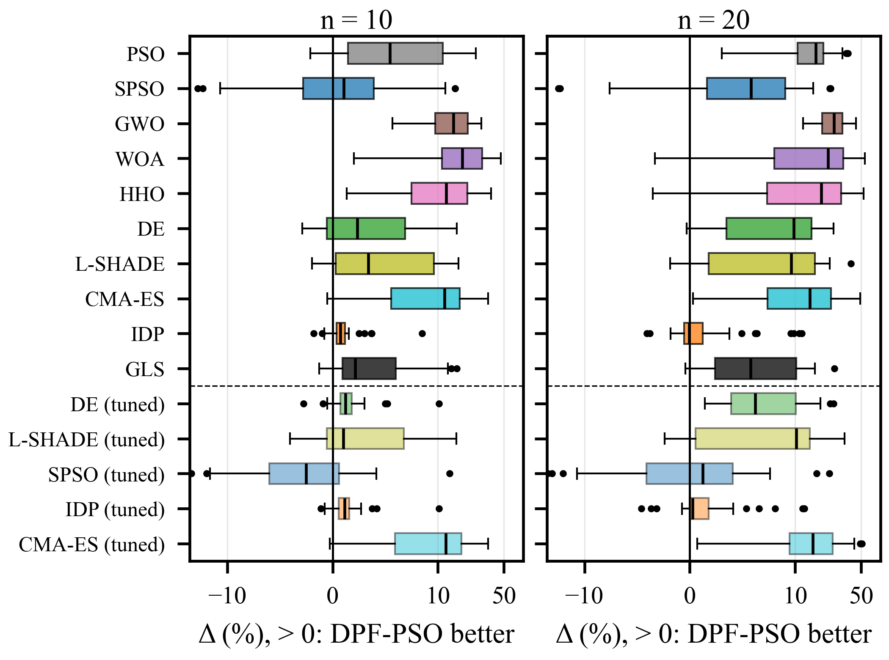

::: {custom-style="Title"}
Dynamic-Programming Path Fusion: An Optimal Recombination Operator for Swarm Optimizers in 3-D UAV Path Planning
:::

::: {custom-style="Author"}
Anonymous Authors\
(author names and affiliations removed for double-blind review)
:::

[[COLS2]]

::: {custom-style="Abstract"}
*Abstract*—Swarm optimizers for three-dimensional (3-D) path planning of unmanned aerial vehicles (UAVs) usually treat the path cost as a black box, although the cost model of Phung and Ha is a sum of terms that each involve at most three consecutive waypoints. We exploit this structure with dynamic-programming path fusion (DPF), an optimal recombination operator that returns, in $O(nK^3)$ time, the least-cost path that can be assembled from $K$ candidate positions per waypoint taken from the swarm memory, perturbations and random samples. Embedded in particle swarm optimization, it gives DPF-PSO. On 40 held-out scenarios with exact ground clearance, DPF-PSO had significantly lower median costs than all black-box metaheuristics with the same waypoint encoding, including DE, L-SHADE and CMA-ES (gaps of 2.3%–18.2% for 10 and 9.6%–25.8% for 20 waypoints). Iterative dynamic programming, which applies the same dynamic program to random candidates, came within 1.1%, so most of the gain comes from exploiting the cost structure, and comparisons with black-box methods alone overstate it. Tuned spherical-vector PSO was better for 10 waypoints because it can merge waypoints and thereby leave the altitude band, which the cost model checks only at waypoints; with the band enforced along the path, tuned DPF-PSO was significantly better for both numbers of waypoints. As a plug-in, DPF lowered the median cost of six host algorithms on the benchmark scenarios by 9.8%–23.1% on average.
:::

::: {custom-style="Keywords"}
*Keywords*—UAV path planning, particle swarm optimization, dynamic programming, optimal recombination, gray-box optimization
:::

# I. Introduction

Path planning lets an unmanned aerial vehicle (UAV) reach its goal while avoiding terrain and threats and respecting its flight limits [1]. In 3-D environments with continuous waypoint coordinates, the problem is usually written as the minimization of a weighted cost over a fixed number of waypoints and solved with population-based metaheuristics, which cope with the non-convex landscape created by obstacles [2]. Particle swarm optimization (PSO) [3] and its variants are among the most used methods, from phase-angle-encoded quantum-behaved PSO [4] to spherical-vector PSO (SPSO) [5], which encodes each segment by its length, elevation and azimuth, and its recent extensions [6]. New metaheuristics are regularly evaluated on this problem [7]–[10], although the value of many metaphor-based designs has been questioned [11].

Most of these methods treat the path cost as a black box, although the cost model of [5], variants of which are used in later work [6], is a sum of terms that depend on one waypoint (altitude), two consecutive waypoints (length, threats, clearance) or three (turning and climbing angles). Gray-box optimization exploits such structure inside evolutionary search [12]; partition crossover, for example, returns the best of exponentially many offspring in linear time [13], [14]. Recombination that returns the best offspring that can be assembled from the parents' genes is called optimal or dynastically optimal recombination [15], [16], and recombination from the whole population gene-pool recombination [17]. Dynamic programming over candidate sets with a three-point term is classical for active contours [18]; driving planners select paths on lattices in station–lateral (Frenet) coordinates by dynamic programming [19], [20]; and iterative dynamic programming solves dynamic programs over candidates sampled in a shrinking region around the current best [21]. We combine these ideas in a different setting: the candidate sets come from the memory of a continuous population-based optimizer, the dynamic program is a plug-in recombination operator, and structure-exploiting competitors separate the effect of the swarm from that of the dynamic program.

This paper makes three contributions:

1\) Dynamic-programming path fusion (DPF), an optimal recombination operator for waypoint-based path encodings. Given candidate positions for each waypoint, taken from the swarm memory, from perturbations and from random samples, DPF returns in $O(nK^3)$ time the least-cost path that can be assembled from them; the result is never worse than any parent, and an exact pruning rule reduces the computation.

2\) DPF-PSO and a plug-in interface for population-based optimizers that use the same slot encoding. With DPF, six different swarm and evolutionary hosts reached nearly the same path costs.

3\) An evaluation on 40 held-out scenarios and the public scenario of [5] with exact ground clearance, an independent safety check, equal tuning budgets and two structure-exploiting baselines. It shows that exploiting the cost structure accounts for most of the improvement over black-box metaheuristics, so that comparisons with black-box methods alone overstate the benefit of new metaheuristics for this cost model, and that the altitude band of the model, checked only at waypoints, favours encodings that can merge waypoints.

# II. Problem Formulation

## A. Environment and Path Representation

The workspace is a rectangular area with terrain elevation $Z(x,y)$ given on a grid of spacing $\delta$ with bilinear interpolation and $N_t$ vertical cylindrical threats with centres $\mathbf{c}_k$ and radii $R_k$. A path consists of the start $S$, waypoints $P_1,\dots,P_n$ and the goal $G$. Let $L$ be the horizontal distance between $S$ and $G$, $\mathbf{e}_1$ the horizontal unit vector from $S$ to $G$ and $\mathbf{e}_2$ its left normal. The segment $SG$ is divided into $n$ slots centred at $B_j=S+j\Delta s\,\mathbf{e}_1$ with $\Delta s=L/(n+1)$, and waypoint $j$ is placed at

$$P_j^{xy}=B_j+\tau_j\Delta s\,\mathbf{e}_1+u_j\mathbf{e}_2,\qquad z_j=Z(P_j^{xy})+h_j$$

with along-track offset $\tau_j\in[-0.45,0.45]$, height above ground $h_j\in[100,200]$ m and lateral offset $u_j\in[-400,400]$ m, narrowed so that $B_j+u_j\mathbf{e}_2$ stays inside the map; a point moved outside the map by $\tau_j$ is clipped to it. The decision vector $\mathbf{x}=(u_j,h_j,\tau_j)_{j=1}^{n}$ has $3n$ variables, as in SPSO. Because the slots do not overlap, waypoints stay ordered along $SG$; this is the station–lateral parametrization of lattice planners [19], [20].

## B. Cost Function and Exact Ground Clearance

We use a modified version of the cost model of Phung and Ha [5] with the weights of their public code, $b_1=5$, $b_2=1$, $b_3=10$, $b_4=1$:

$$J=b_1F_1+b_2F_2+b_3F_3+b_4F_4+\Pi$$

$F_1$ is the 3-D path length. $F_2=\sum_{j,k}\min\{S_d,(R_k+D+S_d-d_{jk})^+\}$ measures how deep segment $j$ enters the danger zone of width $S_d=10$ m around threat $k$, where $d_{jk}$ is the horizontal distance from $\mathbf{c}_k$ to the segment and $D=1$ m the UAV size. $F_3=\sum_j|h_j-150|$ penalizes deviations from the centre of the altitude band $[100,200]$ m, which, as in [5], applies at the waypoints. $F_4$ sums, over the waypoints, the turning angle between the horizontal projections of the two segments that meet there and the change of their climb angles, in degrees. The model differs from [5] in three respects. First, a violated element adds a finite penalty instead of an infinite cost: $M_0=10^5$ for every inflated threat radius $R_k+D$ a segment enters and once more if its minimum ground clearance $c_{\min}$ is below $h_c=20$ m, plus $\lambda=10^3$ times the penetration depths and the shortfall $(h_c-c_{\min})^+$. Second, the clearance is enforced exactly along every segment instead of at the waypoints only. Third, the angle terms are not thresholded; the public code of [5] counts an angle only above 45°, which makes the cost piecewise constant in the angles. As in that code, angles are measured between consecutive non-degenerate segments. The costs reported here are therefore not comparable with those of [5].

Inside a grid cell, the bilinear terrain along a segment is quadratic in the segment parameter and the segment altitude is linear, so the minimum clearance per cell has a closed form; pieces of a segment whose conservative bound already exceeds $h_c$ are skipped. The result agrees with an independent implementation to within $5\times10^{-13}$ m on 7,200 random segments (supplement S1). With $P_0=S$ and $P_{n+1}=G$, every term of $J$ involves at most three consecutive points:

$$J=\sum_{j=1}^{n}A(P_j)+\sum_{j=0}^{n}E(P_j,P_{j+1})+\sum_{j=1}^{n}T(P_{j-1},P_j,P_{j+1})$$

The altitude term $A$ holds $b_3F_3$, the edge term $E$ the length, danger and violation terms, and the turn term $T$ the smoothness terms. $E$ needs terrain and threat computations and dominates the cost of an evaluation; $T$ is cheap arithmetic.

# III. Dynamic-Programming Path Fusion

## A. Fusion Problem and Recursion

Assume that for every slot $j$ a finite set $C_j$ of $K_j$ candidate waypoints is given, with $C_0=\{S\}$, $C_{n+1}=\{G\}$ and $K_0=K_{n+1}=1$. The fusion problem asks for the least-cost path whose $j$-th waypoint belongs to $C_j$ for every $j$; exhaustive search would examine $\prod_jK_j$ paths ($10^{40}$ for $n=20$, $K_j=100$). Because $T$ couples three consecutive points, the state of the dynamic program is the pair of the last two waypoints. Let $W_j(q,r)$, $q\in C_{j-1}$, $r\in C_j$, be the least cost of a partial path ending with $q,r$, including all terms up to $r$ except the turn at $r$. Then $W_1(S,r)=E(S,r)+A(r)$ and, for $j=2,\dots,n+1$, with $p$ ranging over $C_{j-2}$,

$$W_j(q,r)=E(q,r)+A(r)+\min_p\big[W_{j-1}(p,q)+T(p,q,r)\big]$$

with $A(G)=0$; the optimal cost is $J^*=\min_qW_{n+1}(q,G)$, and the minimizing $p$ stored for every $(q,r)$ gives the path by backtracking (Fig. 1).

*Remark 1:* $J^*$ is the least cost over all $\prod_jK_j$ assemblable paths and is not larger than the cost of any parent whose waypoints are in the candidate sets, because no term involves more than three consecutive points (principle of optimality [22]) and every parent is an assemblable path. DPF is therefore an optimal recombination operator in the sense of [15], [16], restricted to the candidate sets; it does not solve the continuous problem exactly.

{width=66mm}

## B. Pruning, Cost Accounting and Pseudo-Code

Each angle in $F_4$ lies in $[0^\circ,180^\circ]$, so $0\le T\le T_{\max}=360\,b_4$. A predecessor $p$ with $W_{j-1}(p,q)>\min_{p'}W_{j-1}(p',q)+T_{\max}$ can never attain the minimum in (4) for any $r$ and is skipped (Algorithm 1, line 5). This pruning is exact; it returned bit-identical results in 324 random test cases and reduced the time of one fusion with $n=20$ and $K_j=100$ by a factor of 1.7. A fusion evaluates $\sum_jK_jK_{j+1}$ edge terms and $\sum_jK_{j-1}K_jK_{j+1}$ turn terms. Because edge terms dominate the cost of an evaluation, a fusion is charged $\lceil\sum_jK_jK_{j+1}/(n+1)\rceil$ function evaluations (FEs), the number of segments evaluated divided by the number of segments of one path; turn terms are not charged, and their cost appears in the CPU-time comparisons.

| **Algorithm 1:** DPF$(C_1,\dots,C_n)$ |
|:--|
| 1: compute $A(r)$ for all candidates and $E(q,r)$ for consecutive slots |
| 2: $W_1(S,r)\leftarrow E(S,r)+A(r)$ for all $r\in C_1$ |
| 3: **for** $j=2,\dots,n+1$ **do** |
| 4:   **for** each $q\in C_{j-1}$: $m_q\leftarrow\min_pW_{j-1}(p,q)$ |
| 5:     $\Pi_q\leftarrow\{p: W_{j-1}(p,q)\le m_q+T_{\max}\}$ (exact pruning) |
| 6:     **for** each $r\in C_j$: $W_j(q,r)\leftarrow E(q,r)+A(r)+\min_{p\in\Pi_q}[W_{j-1}(p,q)+T(p,q,r)]$; store $\arg\min$ |
| 7: $J^*\leftarrow\min_qW_{n+1}(q,G)$; backtrack the stored predecessors |
| 8: **return** the fused path and $J^*$ |

## C. Candidate Sets and DPF-PSO

*Global fusion* uses the $j$-th waypoints of the $N_g=50$ best distinct solutions in the population memory and of $N_r=50$ new uniform random solutions, which are not evaluated individually; it resembles the lattice of [20] with nodes supplied by the swarm. *Local fusion* uses the $N_e=5$ best solutions and $N_p=6$ Gaussian perturbations $\mathbf{x}^*+\sigma(\mathbf{x}_{\max}-\mathbf{x}_{\min})\odot\boldsymbol{\epsilon}$ of the best solution $\mathbf{x}^*$, clipped to the bounds; $\sigma$ starts at 0.05 and is multiplied by 1.5 after a successful local fusion and by 0.75 otherwise, within $[10^{-3},0.2]$. Duplicate solutions and, within a slot, duplicate waypoints are removed. DPF-PSO runs inertia-weight PSO [23] (50 particles, $c_1=c_2=2$, velocity limit 20% of the ranges, inertia weight decreasing linearly from 0.9 to 0.4 with the fraction of the budget used). It applies global fusion to the initial swarm and then, counted in host FEs (FEs not charged to fusion), global fusion every 5,000 and local fusion every 250 host FEs (every 100 and 5 iterations). A fused path that is cheaper than the best personal best replaces the worst one, and that particle is moved to it with zero velocity; a fusion that does not fit into the remaining budget is skipped. Any optimizer with a population memory and the slot encoding can use the operator with the same schedule.

# IV. Experiments

## A. Setup

*Scenarios (Table I):* S1–S6 are synthetic 1 km × 1 km scenarios with a 5 m terrain grid. S1–S4 were used to design DPF-PSO and are the only scenarios used for tuning; S5 and S6 were added after the design was fixed but were used in an earlier test. H01–H40 come from a procedural generator with a new seed family and were not used for any design or tuning decision (only H01 appeared in a two-run smoke test of the pipeline); they carry all confirmatory claims. C1 is the public scenario of [5] (a real elevation model with 1 m pixels and six threats). Each scenario is solved with $n=10$ and $n=20$ waypoints (30 and 60 variables); "S3/20" denotes S3 with $n=20$.

: TABLE I. Scenarios

| Scen. | Elevation (m) | Threats | Start → goal | Use |
|:--|:-:|:-:|:-:|:-:|
| S1 | 20–173 | 4 | (100, 100) → (900, 900) | tuning + test |
| S2 | 30–354 | 6 | (100, 100) → (900, 900) | tuning + test |
| S3 | 26–265 | 10 | (50, 500) → (950, 500) | tuning + test |
| S4 | 20–942 | 12 | (100, 900) → (900, 100) | tuning + test |
| S5 | 20–630 | 14 | (80, 300) → (920, 700) | test |
| S6 | 14–407 | 18 | (500, 60) → (500, 940) | test |
| H01–H40 | 1–859 | 6–18 | random, ≈800 m apart | held-out test |
| C1 [5] | 49–296 | 6 | (199, 99) → (799, 799) | public test |

*Methods:* the black-box baselines are PSO [23] (DPF-PSO without DPF), SPSO [5] with the parameters of its public code but 50 particles (500 in the code; 100 and 500 in supplement S7), the grey wolf optimizer (GWO) [24], the whale optimization algorithm (WOA) [25], Harris hawks optimization (HHO) [26], DE/rand/1/bin [27] ($F=0.5$, $CR=0.9$, 50 members), L-SHADE [28] and CMA-ES [29] with IPOP restarts [30]. Two baselines exploit the cost structure. Iterative dynamic programming (IDP) [21] solves in each round the fusion problem for the incumbent and 19 random candidates per slot drawn in a box around it, whose half-width shrinks geometrically from the full range to $10^{-3}$ of it over the budget. Gray-box local search (GLS) moves one waypoint at a time with 20 Gaussian proposals, re-evaluates only the affected terms (charged $2/(n+1)$ FE per proposal), adapts its step by the 1/5 rule and restarts when the step falls below $10^{-4}$. All methods except SPSO use the slot encoding.

*Tuning:* DE, L-SHADE, SPSO, CMA-ES, IDP and DPF-PSO received the same tuning budget: the default and 24 random configurations from a parameter space, each run with 5 seeds on the 8 instances of S1–S4; the configuration with the lowest mean rank of the median cost was selected (suffix "-T"; supplement S3). Tuning used separate seeds and no test scenario. For CMA-ES, the default configuration was selected. The configuration selected for DPF-PSO, fixed before the held-out runs, is structurally simpler than the default: it uses only the initial global fusion, a fixed step size and more candidates per fusion ($N_r=100$, $N_e=10$, $N_p=12$).

*Budget and statistics:* the budget is $3000n$ FEs. Each method is run 30 times on S1–S6 and C1 and 10 times on each held-out scenario; run $r$ of every method uses the same seed. The gap of DPF-PSO ($P$) to a method $B$ is $\Delta=(\tilde J_B-\tilde J_P)/\tilde J_B$, where $\tilde J$ is the median final cost; $\Delta>0$ means that DPF-PSO is better. *Primary analysis:* on H01–H40, with the scenario as the unit, a two-sided Wilcoxon signed-rank test on the 40 paired scenario medians for each baseline and each $n$, with Holm correction [31] over the 20 tests ($\alpha=0.05$); the tuned configurations form a second family of 10 tests, and each further experiment on H01–H40 (Table III) a family of its own. *Descriptive analysis:* on single instances of S1–S6 and C1, two-sided rank-sum tests with Holm correction over the methods of the table. Mean ranks over S1–S6 are descriptive only, because their 12 instances come from six scenarios and are not independent. All runs used Python 3.13 with NumPy 2.2 in single-threaded processes on an Intel Core i7-14650HX. The supplementary material (S1–S11) is part of the anonymous code repository.

## B. Held-Out Scenarios (Primary Analysis)

With default configurations (Table II, Fig. 2), DPF-PSO was significantly better than every black-box method with the slot encoding, with median gaps of +2.3% to +18.2% for $n=10$ and +9.6% to +25.8% for $n=20$. It reached their final median costs after 16–38% of the budget for $n=20$ and 28–60% for $n=10$ (median over scenarios); for $n=10$, the initial global fusion alone is charged about 26% of the budget. SPSO was the closest black-box method (not significantly different for $n=10$), and GLS, which exploits the decomposition with local moves, was also worse (+2.1%, +5.8%). IDP was the closest competitor: worse by 0.8% for $n=10$ and not significantly different for $n=20$ (Δ̃ = −0.1%). After equal tuning, DPF-PSO remained significantly better than tuned DE, tuned L-SHADE, tuned IDP and tuned CMA-ES for both $n$, whereas tuned SPSO was significantly better for $n=10$ (Δ̃ = −2.5%) and not different for $n=20$ (Δ̃ = +1.2%).

: TABLE II. Paired Comparison on the 40 Held-Out Scenarios

| Method | Win~10~ | Δ̃~10~ | p~H,10~ | Win~20~ | Δ̃~20~ | p~H,20~ |
|:--|:-:|:-:|:-:|:-:|:-:|:-:|
| PSO | 88% | +5.4% | <0.001^+^ | 100% | +16.6% | <0.001^+^ |
| SPSO | 57% | +1.0% | 0.887 | 78% | +5.8% | 0.003^+^ |
| GWO | 100% | +14.5% | <0.001^+^ | 100% | +25.8% | <0.001^+^ |
| WOA | 100% | +18.2% | <0.001^+^ | 95% | +22.4% | <0.001^+^ |
| HHO | 100% | +12.2% | <0.001^+^ | 98% | +19.0% | <0.001^+^ |
| DE | 57% | +2.3% | 0.003^+^ | 95% | +9.9% | <0.001^+^ |
| L-SHADE | 85% | +3.4% | <0.001^+^ | 92% | +9.6% | <0.001^+^ |
| CMA-ES | 98% | +11.8% | <0.001^+^ | 100% | +14.4% | <0.001^+^ |
| IDP | 85% | +0.8% | <0.001^+^ | 45% | −0.1% | 0.887 |
| GLS | 92% | +2.1% | <0.001^+^ | 98% | +5.8% | <0.001^+^ |
| *Tuned:* DE | 90% | +1.2% | <0.001^+^ | 100% | +6.2% | <0.001^+^ |
| L-SHADE | 60% | +1.0% | 0.009^+^ | 85% | +10.3% | <0.001^+^ |
| SPSO | 30% | −2.5% | <0.001^−^ | 65% | +1.2% | 0.656 |
| IDP | 95% | +1.1% | <0.001^+^ | 72% | +0.3% | 0.001^+^ |
| CMA-ES | 98% | +12.1% | <0.001^+^ | 100% | +15.5% | <0.001^+^ |

::: {custom-style="TableNote"}
Subscripts: number of waypoints $n$. Win: share of scenarios on which DPF-PSO (tuned DPF-PSO in the lower block) has the lower median. Δ̃: median of the 40 scenario gaps. p~H~: two-sided signed-rank test on the paired scenario medians, Holm-adjusted over the 20 tests of the upper and the 10 tests of the lower block; ^+^/^−^: significant in favour of / against DPF-PSO.
:::

{width=80mm}

## C. Sources of the Improvement

: TABLE III. Further Paired Comparisons on the Held-Out Scenarios

| Compared with | Win~10~ | Δ̃~10~ | p~H,10~ | Win~20~ | Δ̃~20~ | p~H,20~ |
|:--|:-:|:-:|:-:|:-:|:-:|:-:|
| *Ablation:* PSO (no DPF) | 88% | +5.4% | <0.001^+^ | 100% | +16.6% | <0.001^+^ |
| no global fusion | 85% | +1.8% | <0.001^+^ | 100% | +8.4% | <0.001^+^ |
| greedy, not DP | 80% | +1.6% | <0.001^+^ | 85% | +3.8% | <0.001^+^ |
| fusion only | 100% | +1.9% | <0.001^+^ | 98% | +1.0% | <0.001^+^ |
| *Equal CPU time:* SPSO | 50% | +0.1% | 1.000 | 68% | +4.4% | 0.114 |
| DE | 55% | +2.1% | 0.007^+^ | 88% | +9.5% | <0.001^+^ |
| IDP | 85% | +0.6% | <0.001^+^ | 38% | −0.2% | 1.000 |
| *Band:* SPSO | 98% | +6.0% | <0.001^+^ | 100% | +8.2% | <0.001^+^ |
| DE | 45% | −0.3% | 0.128 | 98% | +6.9% | <0.001^+^ |
| IDP | 90% | +0.5% | <0.001^+^ | 45% | −0.2% | 0.705 |
| *Band, tuned:* SPSO | 88% | +2.8% | <0.001^+^ | 95% | +4.6% | <0.001^+^ |

::: {custom-style="TableNote"}
Columns as in Table II; Holm correction within each experiment, the two band blocks forming one family. Ablation: DPF-PSO against the variant. Equal CPU time: DPF-PSO with its normal budget against the baseline with its budget multiplied by 1.6–1.8, which gives it the CPU time of DPF-PSO (supplement S9). Band: cost model with the band [100, 200] m enforced exactly along every segment.
:::

The ablation on the held-out scenarios (Table III) separates the contributions. Without DPF, PSO was worse by 5.4% for $n=10$ and 16.6% for $n=20$; with a greedy slot-by-slot choice among the same candidates instead of the dynamic program, DPF-PSO was worse by 1.6% and 3.8%, so the optimality of the recombination matters; without global fusion, it was worse by 1.8% and 8.4%; and fusion without PSO moves (DPF-only, which spends the budget on repeated fusions) was worse by 1.9% and 1.0%. The PSO moves thus add a small but significant gain to the dynamic program. As a plug-in on S1–S6 (supplement Table S5b), DPF lowered the median cost of all six hosts, by 9.8% (DE) to 23.1% (GWO) on average, and was significantly worse in 3 of 72 host–instance pairs. With DPF, the medians of the six hosts were within 2.1% of each other on the median instance, against 24.4% without it.

## D. Encoding and the Altitude Band

The advantage of tuned SPSO for $n=10$ comes from its encoding. SPSO can merge consecutive waypoints (segment length $r=0$), and because the altitude band applies only at waypoints, a path with merged waypoints can fly long straight segments that leave the band. On the held-out scenarios with $n=10$, the final paths of tuned SPSO spent on average 28.1% of their horizontal track outside the band, against 4.8% for tuned DPF-PSO (supplement Table S4b), and the more waypoints tuned SPSO merged, the larger its advantage (Spearman's $\rho=$ −0.70, $p=$ $6.0\times10^{-7}$). On H35 its median run merged all waypoints and flew one straight segment up to 377 m above the ground (Fig. 3b). To test this post hoc explanation, we repeated the held-out runs of SPSO, DE, IDP, DPF-PSO, tuned SPSO and tuned DPF-PSO with the band enforced exactly along every segment: a segment closer than 100 m to the ground or more than 200 m above it is penalized like a clearance violation, and its maximum height is computed with the exact clearance method on the mirrored terrain $-Z$ (supplement S4). Tuned SPSO then lost its advantage: tuned DPF-PSO was significantly better for both $n$ (Δ̃ = +2.8% and +4.6%; Table III). With default configurations, DPF-PSO was significantly better than SPSO for both $n$ (Δ̃ = +6.0% and +8.2%), significantly better than IDP for $n=10$ but not significantly different from it for $n=20$ (Δ̃ = +0.5% and −0.2%), and not significantly different from DE for $n=10$ but significantly better than it for $n=20$ (Δ̃ = −0.3% and +6.9%). All runs ended with a feasible path except 1 of the 400 runs of DE for $n=20$.

## E. Further Experiments

On S1–S6 (Table IV and supplement Table S5a), DPF-PSO had the lowest median on 7 of 12 instances and the best mean rank, followed by IDP; only DE was significantly better, on S1/10 and S6/10. On C1, DPF-PSO and tuned DPF-PSO had the lowest median for both $n$ and were significantly better than every other method except GLS for $n=20$. With $n=30$, DPF-PSO had the best mean rank and the lowest median on 4 of 6 instances; IDP was significantly better on S6/30. With $b_2=10$, DPF-PSO and IDP kept the first two mean ranks. With five times the budget, the black-box methods closed much of the gap: the median gap to the best black-box method of each instance fell from 4.7% to 2.1%, because SPSO, GLS and L-SHADE lowered their medians by 5.6%, 5.0% and 1.7%, while DPF-PSO changed by at most 0.5%; DPF-PSO kept the best mean rank but had the lowest median on only 3 of 12 instances. Its advantage at the standard budget is therefore partly one of speed. At equal CPU time, DPF-PSO kept the best mean rank on S1–S6, and on the held-out scenarios (Table III) it was significantly better than DE for both $n$ (Δ̃ = +2.1% and +9.5%), significantly better than IDP for $n=10$ but not significantly different from it for $n=20$ (Δ̃ = +0.6% and −0.2%), and not significantly different from SPSO for either $n$ (Δ̃ = +0.1% and +4.4%).

[[WIDE]]

{width=178mm}

[[/WIDE]]

: TABLE IV. Benchmark, Public and Sensitivity Experiments (Descriptive; +/≈/− as in Supplement Tables S5–S6)

| Experiment | Inst. | Lowest median | Rank: DPF-PSO / best other | vs. IDP | vs. best black-box |
|:--------------|:---:|:------:|:----------------:|:------:|:-----------:|
| S1–S6 | 12 | 7 | 1.42 / 2.50 (IDP) | 8/4/0 | 8/2/2 (DE) |
| Tuned | 12 | 8 | 1.58 / 2.50 (IDP) | 10/2/0 | 8/2/2 (SPSO) |
| C1 [5] | 2 | 2 | 1.00 / 2.50 (IDP) | 2/0/0 | 2/0/0 (DE) |
| Tuned | 2 | 2 | 1.00 / 2.50 (IDP) | 2/0/0 | 2/0/0 (SPSO) |
| n = 30 | 6 | 4 | 1.33 / 2.17 (IDP) | 1/4/1 | 6/0/0 (SPSO) |
| 5× budget | 12 | 3 | 2.58 / 2.92 (IDP) | 0/11/1 | 6/5/1 (SPSO) |
| b~2~ = 10 | 12 | 7 | 1.58 / 2.83 (IDP) | 1/11/0 | 7/3/2 (DE) |
| Equal time | 12 | 7 | 1.75 / 2.83 (IDP) | 5/6/1 | 8/1/3 (DE) |

::: {custom-style="TableNote"}
Inst.: instances. Tuned: tuned configurations on the instances of the row above; the last four rows refer to S1–S6. Lowest median: instances on which DPF-PSO (tuned DPF-PSO in the tuned rows) has the lowest median. vs.: +/≈/− of DPF-PSO against IDP and against the black-box method with the best mean rank in that experiment (rank-sum tests, Holm over the methods of each instance). Runs per instance: 30 (S1–S6, C1, equal time), 20 ($n=30$), 10 (5× budget, $b_2=10$). Equal time: baselines with budgets multiplied by 1.3–2.0.
:::

## F. Computational Cost and Safety

Fusion took 64% of the FE budget of DPF-PSO for both $n$, with 2 and 4 global fusions (97 and 92 distinct candidates per slot on average) and 42 and 86 local fusions per run for $n=10$ and $n=20$. Because turn terms are not charged, a run took 1.99 s and 6.57 s of CPU time on one performance core, 1.8 and 1.7 times the median of the black-box baselines other than CMA-ES; CMA-ES and GLS took longer than DPF-PSO. An independent check that does not use the cost function (supplement S10) re-evaluated all 42,080 final paths of all experiments with analytic threat distances and an independently implemented exact clearance, which for the altitude-band variant also checked the band along every segment. With a tolerance of $10^{-6}$ m, no path that the cost function reported as feasible violated a constraint; the only disagreements were 2 paths that the cost function rejected and the check accepted, all within $10^{-12}$ m of the clearance limit (rounding). With the weights of [5], one metre of extra length costs five times as much as one metre of danger-zone intrusion, so 13% of the feasible paths (20% for DPF-PSO) pass within 1 mm of an inflated threat radius; with $b_2=10$ the share fell to 2%. Applications should choose the danger weight or an explicit margin according to their safety requirements.

# V. Discussion and Limitations

*Benchmarking.* DPF-PSO and IDP both solve fusion problems exactly, and their median gap was at most 1.1%, whereas the black-box methods with the same encoding were 2.3% to 25.8% worse. Comparisons with black-box metaheuristics alone thus say little about a new search mechanism for this cost model; structure-exploiting baselines such as IDP should be included. The swarm adds a small but significant gain, and with DPF the choice of the host algorithm hardly matters, so DPF can be added to existing swarm planners.

*Cost model.* The altitude band of [5] applies at the waypoints only, and encodings that can merge waypoints exploit this: the advantage of tuned SPSO for $n=10$ went with long segments outside the band and turned into a significant disadvantage when the band was enforced along the path. If the band expresses a requirement on the whole flight, it should be enforced along the segments; the exact clearance computation extends to it, and DPF needs no change because the constraint is an edge term.

*Scope.* The results hold for static, known environments, a single UAV and a budget of $3000n$ FEs, beyond which DPF-PSO improved little; the held-out scenarios come from one generator, and C1 is the only real terrain. At equal FEs, DPF-PSO needs about 1.7 times the CPU time of typical black-box baselines; at equal CPU time, it was not significantly better than SPSO (either $n$) and IDP ($n=20$) on the held-out scenarios. The slot encoding cannot represent paths that move backwards along $SG$ or merge waypoints; transitions between non-adjacent slots would allow merging while keeping the three-point structure. Costs with global terms, such as a time budget, would need a larger state.

# VI. Conclusion

The UAV path cost of [5] decomposes into terms over at most three consecutive waypoints, and DPF uses this to return the best path that can be assembled from the swarm memory and sampled candidates. On 40 held-out scenarios, DPF-PSO was better than all black-box metaheuristics with the same encoding and reached their final costs with a fraction of the budget, while iterative dynamic programming came within about one percent: most of the improvement comes from exploiting the cost structure. The advantage of tuned SPSO for 10 waypoints relied on leaving the altitude band between waypoints and was reversed when the band was enforced along the path. Future work will extend DPF to transitions between non-adjacent slots, to multiple UAVs and to dynamic threats.

# Code and Data Availability

The code, the scenario generators, all seeds, the raw results, the supplementary material and the scripts that produce every number, table and figure of this paper are available at [anonymous repository link to be inserted by the authors].

# Acknowledgment

[Generative-AI disclosure required by the ICAISI 2027 guidelines; the authors must check and complete it before submission. Draft: The authors used Kiro, an AI agent in the Kiro IDE (underlying model Claude Opus 5.5, Anthropic), for literature search, implementation of the code, execution of the experiments, statistical analysis, preparation of the figures and tables, and drafting of the text. The authors [describe their own contributions, e.g., defined the research question, checked the derivations and the code, reproduced the main results, and revised the text] and take full responsibility for the content of this paper.]

# References

::: {custom-style="Reference"}
[1] S. Aggarwal and N. Kumar, "Path planning techniques for unmanned aerial vehicles: A review, solutions, and challenges," *Comput. Commun.*, vol. 149, pp. 270–299, 2020.

[2] M. Hooshyar and Y.-M. Huang, "Meta-heuristic algorithms in UAV path planning optimization: A systematic review (2018–2022)," *Drones*, vol. 7, no. 12, Art. no. 687, 2023.

[3] J. Kennedy and R. Eberhart, "Particle swarm optimization," in *Proc. ICNN'95 Int. Conf. Neural Netw.*, vol. 4, 1995, pp. 1942–1948.

[4] Y. Fu, M. Ding, and C. Zhou, "Phase angle-encoded and quantum-behaved particle swarm optimization applied to three-dimensional route planning for UAV," *IEEE Trans. Syst., Man, Cybern. A, Syst., Humans*, vol. 42, no. 2, pp. 511–526, 2012.

[5] M. D. Phung and Q. P. Ha, "Safety-enhanced UAV path planning with spherical vector-based particle swarm optimization," *Appl. Soft Comput.*, vol. 107, Art. no. 107376, 2021.

[6] Y. Liu, H. Zhang, H. Zheng, Q. Li, and Q. Tian, "A spherical vector-based adaptive evolutionary particle swarm optimization for UAV path planning under threat conditions," *Sci. Rep.*, vol. 15, Art. no. 2116, 2025.

[7] S. Fu, K. Li, H. Huang, C. Ma, Q. Fan, and Y. Zhu, "Red-billed blue magpie optimizer: A novel metaheuristic algorithm for 2D/3D UAV path planning and engineering design problems," *Artif. Intell. Rev.*, vol. 57, no. 6, Art. no. 134, 2024.

[8] Z. Zhan, D. Lai, C. Huang, Z. Zhang, Y. Deng, and J. Yang, "MSCSO: A modified sand cat swarm algorithm for 3D UAV path planning in complex environments with multiple threats," *Sensors*, vol. 25, no. 9, Art. no. 2730, 2025.

[9] Y. Wang, J. Liu, Y. Qian, and W. Yi, "Path planning for multi-UAV in a complex environment based on reinforcement-learning-driven continuous ant colony optimization," *Drones*, vol. 9, no. 9, Art. no. 638, 2025.

[10] F. Rasoulie and S. Pashazadeh, "3D UAV path optimization using a task-allocation and archive-guided mutation particle swarm optimization algorithm," *Sci. Rep.*, vol. 16, Art. no. 24356, 2026.

[11] K. Sörensen, "Metaheuristics—the metaphor exposed," *Int. Trans. Oper. Res.*, vol. 22, no. 1, pp. 3–18, 2015.

[12] L. D. Whitley, F. Chicano, and B. W. Goldman, "Gray box optimization for Mk landscapes (NK landscapes and MAX-kSAT)," *Evol. Comput.*, vol. 24, no. 3, pp. 491–519, 2016.

[13] D. Whitley, D. Hains, and A. Howe, "Tunneling between optima: Partition crossover for the traveling salesman problem," in *Proc. 11th Annu. Conf. Genet. Evol. Comput. (GECCO)*, 2009, pp. 915–922.

[14] R. Tinós, D. Whitley, and F. Chicano, "Partition crossover for pseudo-Boolean optimization," in *Proc. ACM Conf. Found. Genet. Algorithms (FOGA XIII)*, 2015, pp. 137–149.

[15] C. Cotta, E. Alba, and J. M. Troya, "Utilizing dynastically optimal forma recombination in hybrid genetic algorithms," in *Parallel Problem Solving from Nature—PPSN V* (LNCS 1498), 1998, pp. 305–314.

[16] A. V. Eremeev and J. V. Kovalenko, "Optimal recombination in genetic algorithms for combinatorial optimization problems: Part I," *Yugosl. J. Oper. Res.*, vol. 24, no. 1, pp. 1–20, 2014; "Part II," vol. 24, no. 2, pp. 165–186, 2014.

[17] H. Mühlenbein and H.-M. Voigt, "Gene pool recombination in genetic algorithms," in *Meta-Heuristics: Theory and Applications*, I. H. Osman and J. P. Kelly, Eds. Boston, MA, USA: Kluwer, 1996, pp. 53–62.

[18] A. A. Amini, T. E. Weymouth, and R. C. Jain, "Using dynamic programming for solving variational problems in vision," *IEEE Trans. Pattern Anal. Mach. Intell.*, vol. 12, no. 9, pp. 855–867, 1990.

[19] M. Werling, J. Ziegler, S. Kammel, and S. Thrun, "Optimal trajectory generation for dynamic street scenarios in a Frenét frame," in *Proc. IEEE Int. Conf. Robot. Autom. (ICRA)*, 2010, pp. 987–993.

[20] H. Fan *et al.*, "Baidu Apollo EM motion planner," arXiv:1807.08048, 2018.

[21] R. Luus, *Iterative Dynamic Programming*. Boca Raton, FL, USA: Chapman & Hall/CRC, 2000.

[22] R. Bellman, *Dynamic Programming*. Princeton, NJ, USA: Princeton Univ. Press, 1957.

[23] Y. Shi and R. Eberhart, "A modified particle swarm optimizer," in *Proc. IEEE Int. Conf. Evol. Comput.*, 1998, pp. 69–73.

[24] S. Mirjalili, S. M. Mirjalili, and A. Lewis, "Grey wolf optimizer," *Adv. Eng. Softw.*, vol. 69, pp. 46–61, 2014.

[25] S. Mirjalili and A. Lewis, "The whale optimization algorithm," *Adv. Eng. Softw.*, vol. 95, pp. 51–67, 2016.

[26] A. A. Heidari, S. Mirjalili, H. Faris, I. Aljarah, M. Mafarja, and H. Chen, "Harris hawks optimization: Algorithm and applications," *Future Gener. Comput. Syst.*, vol. 97, pp. 849–872, 2019.

[27] R. Storn and K. Price, "Differential evolution—A simple and efficient heuristic for global optimization over continuous spaces," *J. Global Optim.*, vol. 11, no. 4, pp. 341–359, 1997.

[28] R. Tanabe and A. S. Fukunaga, "Improving the search performance of SHADE using linear population size reduction," in *Proc. IEEE Congr. Evol. Comput. (CEC)*, 2014, pp. 1658–1665.

[29] N. Hansen and A. Ostermeier, "Completely derandomized self-adaptation in evolution strategies," *Evol. Comput.*, vol. 9, no. 2, pp. 159–195, 2001.

[30] A. Auger and N. Hansen, "A restart CMA evolution strategy with increasing population size," in *Proc. IEEE Congr. Evol. Comput. (CEC)*, vol. 2, 2005, pp. 1769–1776.

[31] S. Holm, "A simple sequentially rejective multiple test procedure," *Scand. J. Statist.*, vol. 6, no. 2, pp. 65–70, 1979.
:::
