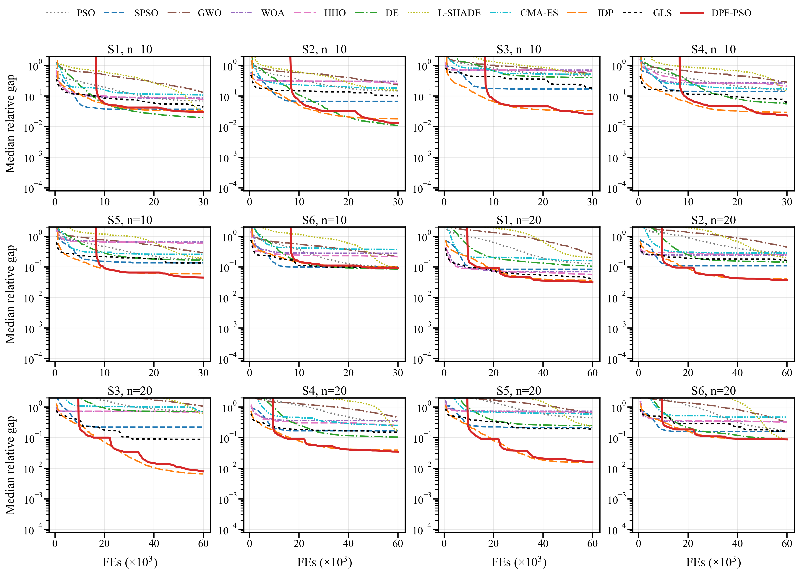
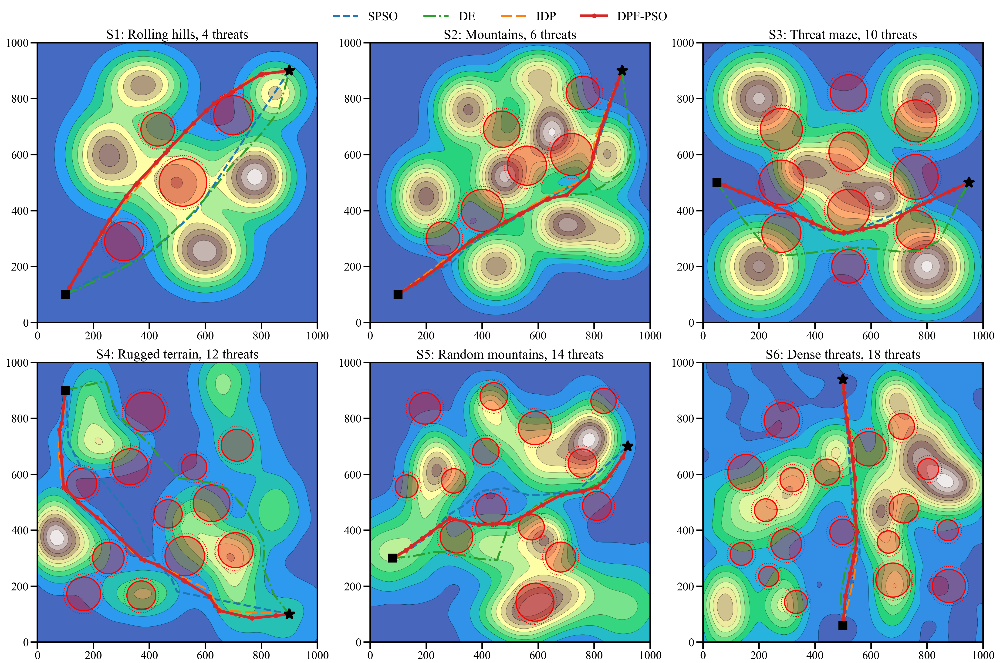
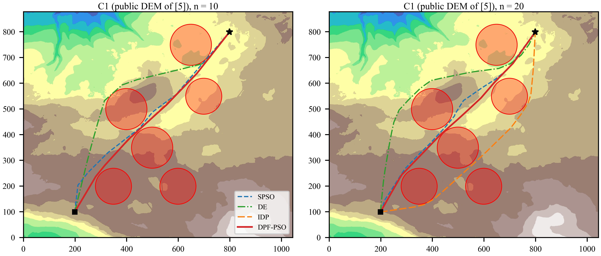

::: {custom-style="Title"}
Supplementary Material for "@@TITLE@@"
:::

::: {custom-style="Author"}
Anonymous Authors
:::

[[COLS2]]

All numbers in this supplement are generated from the stored results by `src/analysis2.py` and `paper/build2.py` of the code package. Notation follows the paper: $\tilde J$ is the median final cost over runs, $\Delta=(\tilde J_B-\tilde J_P)/\tilde J_B$ is the gap of the proposed configuration $P$ to method $B$ ($\Delta>0$: $P$ better), $A_{12}$ is the probability that a run of $P$ ends with a lower cost than a run of $B$, and +/≈/− means $P$ significantly better / not significantly different / significantly worse after Holm correction.

# S1. Exact Ground Clearance

Let a segment run from $\mathbf{a}$ to $\mathbf{b}$, $\mathbf{p}(t)=\mathbf{a}+t(\mathbf{b}-\mathbf{a})$, $t\in[0,1]$. Inside the grid cell with corners $z_{00},z_{01},z_{10},z_{11}$ the terrain is $Z=z_{00}+(z_{01}-z_{00})\xi+(z_{10}-z_{00})\eta+(z_{00}-z_{01}-z_{10}+z_{11})\xi\eta$ with local coordinates $\xi,\eta\in[0,1]$ that are affine in $t$. Hence $Z(t)$ is a quadratic polynomial on the parameter interval $[t_0,t_1]$ in which the segment crosses the cell, and so is the clearance $c(t)=p_z(t)-Z(t)$. Its minimum over $[t_0,t_1]$ is attained at $t_0$, at $t_1$ or, if $c$ is convex there, at the stationary point. The cost function evaluates this minimum for every crossed cell. To save time, a segment is cut into pieces of at most four cells; for each piece, a lower bound of the clearance (lowest altitude of the piece minus the maximum terrain height in a window that contains it, taken from max-pooled terrain maps with window sizes 1, 2, 4 and 8 cells) is computed first, and the exact evaluation is skipped if the bound is at least $h_c$. The violation $(h_c-c_{\min})^+$ is therefore exact, and the reported minimum clearance of final paths is computed without screening.

Verification (`src/check_clearance.py`, results in `notes/clearance_check.json`): on @@clr_nseg@@ random segments in S1–S6, H01, H17 and C1 (half of them with endpoints 10–60 m above the ground, so that the minimum lies near the 20 m threshold), the vectorized implementation agreed with an independently written implementation (`src/clearance_ref.py`, which splits the segment at every grid-line crossing and reconstructs each quadratic from three terrain evaluations) to within @@clr_maxdiff@@ m, and the violations agreed to within @@clr_vdiff@@ m. Dense sampling with 10,001 points per segment never gave a lower clearance than the exact minimum and exceeded it by at most @@clr_dense@@ m. The violation of a segment did not depend on the other segments evaluated in the same batch.

# S2. Implementation Details and Protocol

1. *Inertia weight.* PSO (alone and inside DPF-PSO) decreases the inertia weight linearly from 0.9 to 0.4 with the fraction of the FE budget used, because the number of iterations is not known in advance when fusion consumes FEs. SPSO uses $w=w_0(w_{\mathrm{end}}/w_0)^{\phi}$ with $\phi$ the fraction of the budget used; the default reproduces the schedule of its public code ($w_0=1$, damping 0.98 per iteration over 200 iterations).
2. *Budget.* The evaluator stops exactly at the budget: rows of a batch beyond the budget are not evaluated. A fusion is skipped if its FE charge exceeds the remaining budget; the host then uses the rest. IDP fills a remainder smaller than one round with random samples; GLS charges whole FEs when the accumulated fractional charge exceeds one.
3. *Map limits.* The bounds of $u_j$ are the intersection of $[-400,400]$ m with the offsets for which $B_j+u_j\mathbf{e}_2$ lies in the map shrunk by 5 m; after the along-track shift, coordinates are clipped to the same rectangle. All slot-encoded methods share this decoder. SPSO clips every waypoint to the same rectangle and its height above ground to [100, 200] m, as in its public code.
4. *Violations.* Each segment adds $M_0$ for every threat whose inflated radius $R_k+D$ it enters and once more if its exact minimum clearance is below $h_c$, plus $\lambda$ times the sum of the penetration depths and of the clearance shortfall. A run is feasible if its final path has no violation.
5. *Random candidates.* The $N_r$ random solutions of a global fusion are not evaluated as paths and are not charged; only the segment evaluations of the fusion are charged.
6. *Distinctness.* Global fusion selects the $N_g$ best solutions with distinct decision vectors (exact equality); within every slot, duplicate waypoints are removed before the dynamic program.
7. *Seeds.* Pilot runs of the first study used seeds 20270201 + $r$, tuning used 30270000 + $r$, all final runs use 20271101 + $r$ (run $r$ of every method gets the same seed), the timing benchmark 40270000 + $r$, and held-out scenario H$k$ is generated from seed 90210 + $k$.
8. *Smoothness term.* $F_4$ follows Eq. (8) of [5] with unit coefficients; the public code of [5] adds an angle only if it exceeds 45°, which makes the cost piecewise constant in the angles. Segments with zero horizontal length, which only the spherical encoding of SPSO can produce, are skipped and the angles are measured between consecutive non-degenerate segments, as the public code does for the turning angle. Without this rule, an implementation that assigns a zero turn to such segments lets SPSO hide sharp turns behind collapsed waypoints.
9. *SPSO azimuth.* The public SPSO code swaps sine and cosine of the azimuth; we use the mapping that is consistent with the azimuth bounds. This matters only when $SG$ is not diagonal.
10. *CMA-ES.* pycma 4.5.0 on the slot encoding scaled to $[0,1]^{3n}$, bound handling of pycma, initial mean uniform at random, initial step 0.3, default population size $4+\lfloor3\ln(3n)\rfloor$ doubled at every restart (IPOP). A run restarts when the step size falls below $10^{-3}$ (pycma option tolx), when the recent best costs vary by less than 1 (tolfun, tolfunhist; costs are of the order of $10^3$–$10^4$), or after 200 iterations without progress (tolstagnation). With pycma's default thresholds, which we used first, the first run never stopped within $3000n$ FEs, so IPOP never restarted. We noticed this in the first CMA-ES results on S1–S6, chose the thresholds above in a check on S1 and S3 with four tuning seeds (`notes/check_cmaes2.py`; median on S3 with $n=10$: @@cma_old_s3@@ with the default thresholds, @@cma_new_s3@@ with the new ones), and re-ran CMA-ES in all experiments; the earlier CMA-ES results are not used.
11. *L-SHADE.* Initial population $18\cdot3n$ reduced linearly to 4, memory size 6, archive rate 2.6, $p=0.11$ (defaults of [28]). For the plug-in variant, DPF uses the current population as memory.
12. *Plug-in hosts.* DE and L-SHADE pass their population to DPF; GWO, WOA and HHO pass their population together with their leaders (the three best wolves, the best whale, the rabbit). An accepted fused path replaces the worst member. SPSO is not used as a host, because in its spherical encoding the $j$-th waypoint is not tied to slot $j$.

*Development history.* A first version of this study used a sampled clearance check (20 points per segment) and an iteration-based fusion schedule; its results are not used here. In the present study, the cost function (exact clearance, degenerate segments), the fusion schedule (counted in host FEs), the baselines and the tuning protocol were fixed before the final runs; the only later change concerns the restart thresholds of the CMA-ES baseline (item 10), which were changed after its first results on S1–S6 and before any of its held-out results existed. A two-run smoke test of the pipeline on S4, H01 and C1, run before the final experiments, revealed the zero-turn loophole described in item 8; the fix changed only the cost function, identically for all methods, and no algorithm or parameter was changed after the smoke test. The smoke-test results were discarded. After the held-out results were known, we added the tuning of CMA-ES (S3), the height-above-ground analysis, the held-out ablation and equal-time comparisons, and the altitude-band variant (S4). DPF-PSO, its default and tuned configurations and all earlier results were left unchanged. The altitude-band experiment tests an explanation that was suggested by the held-out results and is therefore exploratory.

# S3. Parameter Tuning

Each tuned method (DE, L-SHADE, SPSO, IDP, DPF-PSO and CMA-ES) received the default configuration plus 24 configurations drawn at random from the space below, each run with 5 seeds on S1–S4 with $n\in\{10,20\}$ (1,000 runs per method). The score of a configuration is the rank of its median cost among the 25 configurations on each instance, averaged over the 8 instances; ties are broken by the mean normalized median.

* DE: strategy ∈ {rand/1/bin, best/1/bin, current-to-best/1/bin}, $F\sim U(0.3,1)$, $CR\sim U(0,1)$, NP ∈ {20, 50, 100, 5D, 10D}.
* L-SHADE: $r^{N_{\mathrm{init}}}$ ∈ {5, 10, 18, 25}, $p\sim U(0.05,0.25)$, $H$ ∈ {5, 6, 10, 20}, $r^{\mathrm{arc}}\sim U(1,3)$.
* SPSO: $N$ ∈ {30, 50, 100, 200, 500}, $c_1,c_2\sim U(1,2.5)$, $w_0\sim U(0.5,1.2)$, $w_{\mathrm{end}}\sim\log U(0.005,0.5)$, velocity limit $\alpha\sim U(0.1,1)$.
* IDP: $K$ ∈ {10, 15, 20, 30, 40}, $r_{\min}\sim\log U(10^{-4},10^{-1})$, initial sample $N_0$ ∈ {20, 50, 100}.
* DPF-PSO: $N_r$ ∈ {0, 25, 50, 100}, $N_g$ ∈ {25, 50}, global period ∈ {0 (initial fusion only), 2500, 5000, 10000} host FEs, local period ∈ {100, 250, 500, 1000}, $N_e$ ∈ {2, 5, 10}, $N_p$ ∈ {3, 6, 12}, $\sigma_0\sim\log U(0.01,0.2)$, adaptive $\sigma$ ∈ {yes, no}.
* CMA-ES (tuned with the same protocol after the other methods): $\sigma_0\sim\log U(0.05,0.6)$, population size multiplier ∈ {1, 2, 4, 8}, tolx $\sim\log U(10^{-4},10^{-2})$, tolfun $\sim\log U(0.1,10)$, tolstagnation ∈ {100, 200, 400}. The default configuration had the best mean rank, so tuned CMA-ES is identical to CMA-ES.

The selected configuration of DPF-PSO uses only the initial global fusion (global period 0) and a fixed step size, so neither periodic global fusion nor the success-based step rule was part of the best configuration found; it was selected on S1–S4 before any held-out run.

: TABLE S1. Selected Configurations (Mean Rank among 25 Configurations on S1–S4)

@@S_TUNING@@

# S4. Held-Out Scenarios

: TABLE S2. Default Configurations on H01–H40: Paired Comparison of DPF-PSO with Each Method

@@S_HELDOUT@@

::: {custom-style="TableNote"}
Win / loss: share of the 40 scenarios on which DPF-PSO has the lower / higher median. Δ̃ [Q1, Q3]: median and quartiles of the 40 scenario gaps. Within-scenario +/≈/−: rank-sum tests on each scenario (10 runs per method), Holm over the 10 methods. p: two-sided Wilcoxon signed-rank test on the 40 paired scenario medians; p~H~: Holm-adjusted over the @@n_primary@@ tests of this table.
:::

: TABLE S3. Mean Rank and Share of Feasible Runs on H01–H40

@@S_HELDOUT_RANKS@@

: TABLE S4. Tuned Configurations on H01–H40 (Reference: DPF-PSO-T)

@@S_HELDOUT_TUNED@@

::: {custom-style="TableNote"}
As Table S2, with the tuned configurations; Holm over the @@n_secondary@@ tests of this table.
:::

*Merged waypoints of tuned SPSO.* Tuned SPSO had a lower median than tuned DPF-PSO on @@mg_a_better10@@ ($n=10$) and @@mg_a_better20@@ ($n=20$) of the 40 scenarios. The final paths of tuned SPSO had a median of @@mg_merged10@@ and @@mg_merged20@@ merged waypoints (segments of zero horizontal length) and median longest segments of @@mg_maxseg_a10@@ m and @@mg_maxseg_a20@@ m, against @@mg_maxseg_b10@@ m and @@mg_maxseg_b20@@ m for tuned DPF-PSO. Spearman's correlation between the mean number of merged waypoints of a scenario and the gap $(\tilde J_{\mathrm{SPSO}}-\tilde J_{\mathrm{DPF}})/\tilde J_{\mathrm{SPSO}}$ was @@mg_rho10@@ ($p=$ @@mg_p10@@) for $n=10$ and @@mg_rho20@@ ($p=$ @@mg_p20@@) for $n=20$: the more waypoints tuned SPSO merged, the larger its advantage.

*Anytime behaviour.* The best-so-far costs of the held-out runs were recorded at 101 equally spaced points of the budget. Table S4a gives the gap of DPF-PSO at half and at the full budget, and the share of the budget after which the median best-so-far cost of DPF-PSO first reached the final median cost of the other method (median over the scenarios; "never" if this happened on fewer than half of them). For $n=10$, the initial global fusion of DPF-PSO is charged at once and takes about a quarter of the budget, so DPF-PSO cannot reach any target before that point.

: TABLE S4a. Anytime Comparison on H01–H40 (Default Configurations)

@@S_ANYTIME@@

*Height above ground along the paths.* Table S4b reports, for the final paths on H01–H40, the share of the horizontal track below 100 m and above 200 m above the ground (1 m sampling, mean over paths) and the median minimum and maximum height. The altitude band of the cost model applies only at the waypoints. Table S4c gives the same for the variant in which the band is enforced exactly along every segment; the maximum height of a segment is computed with the exact clearance machinery applied to the mirrored terrain $-Z$ (`src/check_ceiling.py`: agreement with the independent implementation to within @@ceil_maxdiff@@ m on @@ceil_nseg@@ random segments), and the independent safety check of S10 verifies the band along the segments for this variant. Band violations of up to $10^{-6}$ m are ignored in this variant, because waypoints lie exactly on the band limits ($h_j\in[100,200]$ m), where rounding of the order of $10^{-13}$ m would otherwise decide about a penalty of $M_0$.

: TABLE S4b. Height above Ground along the Final Held-Out Paths

@@S_AGL@@

: TABLE S4c. As Table S4b, Altitude Band Enforced along Every Segment

@@S_AGL_BAND@@

*Further held-out experiments.* Tables S4d–S4h give the details of the comparisons in Table III of the paper. The ablation variants and the baselines at equal CPU time were run with the same seeds as the held-out runs of Table S2; DPF-PSO is represented by its runs of Table S2 with its normal budget. The altitude-band experiment is a complete re-run of the six methods with the modified cost model; its costs are not comparable with those of the other tables.

: TABLE S4d. Held-Out Ablation: DPF-PSO against Each Variant

@@S_HO_ABL@@

: TABLE S4e. Held-Out Scenarios at Equal CPU Time: DPF-PSO (Normal Budget) against Baselines with Multiplied Budgets

@@S_HO_EQ@@

: TABLE S4f. Altitude Band Enforced along Every Segment: DPF-PSO against Default Baselines

@@S_HO_BAND@@

: TABLE S4g. Altitude Band Enforced along Every Segment: Tuned DPF-PSO against Tuned SPSO

@@S_HO_BANDT@@

::: {custom-style="TableNote"}
Columns as in Table S2. Holm correction over the @@hab_ntests@@ tests of Table S4d, the @@heq_ntests@@ tests of Table S4e, and the @@hbd_ntests@@ tests of Tables S4f and S4g together.
:::

: TABLE S4h. Share of Runs with a Feasible Final Path, Altitude Band Enforced along Every Segment

@@S_HO_BAND_FEAS@@

# S5. Benchmark Instances S1–S6

: TABLE S5a. Median Final Cost on S1–S6 (30 Runs, Default Configurations)

@@S_MAIN@@

::: {custom-style="TableNote"}
"S3/20": S3 with n = 20. +/≈/−: DPF-PSO significantly better / not different / significantly worse (two-sided rank-sum test, Holm over the 10 methods of each instance, α = 0.05); descriptive only. ^†^: some runs infeasible. Bold: lowest median. \*: S5 and S6 were not used for design or tuning. Rank: mean rank of the median over the 12 instances.
:::

: TABLE S5b. Ablation and Plug-in Study on S1–S6 (Δ Averaged over 12 Instances)

@@S_SOURCES@@

::: {custom-style="TableNote"}
Ablation: Δ of DPF-PSO to the variant; +/≈/−: DPF-PSO significantly better / not different / worse (rank-sum, Holm over the 7 variants). Plug-in: Δ of the host with DPF to the host alone; +/≈/−: host with DPF significantly better / not different / worse (Holm over the 12 instances); PSO + DPF is DPF-PSO (row PSO). Rank: mean rank among the eight ablation configurations.
:::

: TABLE S5. Default Configurations, n = 10 (30 Runs)

@@S_MAIN10@@

: TABLE S6. Default Configurations, n = 20 (30 Runs)

@@S_MAIN20@@

::: {custom-style="TableNote"}
Δ, A~12~ and sign refer to DPF-PSO against the method in the row; Holm over the 10 methods of each instance.
:::

: TABLE S7. Tuned Configurations on S1–S6 (Median, 30 Runs; Reference: DPF-PSO-T)

@@S_TUNED@@

# S6. Additional Experiments

*Public scenario C1.* The scenario of the public SPSO code: the Christmas Island elevation model (1 m per pixel as in that code, bilinear interpolation instead of rounding to the nearest pixel), its six threats and its start and goal. Start and goal heights are 150 m above ground.

: TABLE S8. C1, Default Configurations (Median, 30 Runs)

@@S_PUBLIC@@

: TABLE S9. S1–S6 with n = 30 (Median, 20 Runs, Budget 90,000 FEs)

@@S_N30@@

: TABLE S10. S1–S6 with a Five Times Larger Budget (Median, 10 Runs)

@@S_BUDGET5@@

: TABLE S11. S1–S6 with Danger Weight b~2~ = 10 (Median, 10 Runs)

@@S_B2@@

: TABLE S12. Equal CPU Time: Baselines with Multiplied Budgets against DPF-PSO with Its Normal Budget (Median, 30 Runs)

@@S_EQTIME@@

# S7. Population-Size Sensitivity

: TABLE S13. DPF-PSO against DE and SPSO with Other Population Sizes (S1–S6, 30 Runs)

@@S_SENS@@

# S8. Composition of the FE Budget of DPF-PSO

: TABLE S14. FE Composition, Number and Size of Fusions per Run (Mean over S1–S6 and 30 Runs)

@@S_FE@@

::: {custom-style="TableNote"}
Host FEs: FEs of the PSO moves and the initial swarm. Mean K: mean candidate-set size per slot after removing duplicates. Improving: fusions per run whose result became the new best.
:::

# S9. Timing

CPU times come from a separate benchmark (`src/timing_benchmark.py`): 8 worker processes, each pinned to one logical processor of a different performance core of the i7-14650HX (the efficiency cores were not used), 5 runs per method and instance on S1–S6, methods interleaved. The equal-time multiplier of a baseline is the ratio of the CPU time of DPF-PSO to its own, rounded to one decimal and at least 1.0.

@@S_TIMING@@

# S10. Safety Check

Every final path of every experiment was re-checked by `src/verify_paths.py`, which does not use the cost function: threat distances are computed with an analytic point-to-segment distance in a plain loop, and ground clearance with the independent exact implementation of S1. A path is independently feasible if it keeps a horizontal distance of at least $R_k+D$ from every threat centre and an exact clearance of at least 20 m (tolerance $10^{-6}$ m). In the experiment with the altitude band enforced along the segments (@@safe_band_paths@@ of the paths in Table S15), a path must in addition stay at least 100 m and at most 200 m above the ground along every segment; the maximum height is computed by the same independent implementation applied to the mirrored terrain $-Z$. In this variant the cost function ignores band violations of up to $10^{-6}$ m (S4), and optimizers can end exactly on that tolerance: for @@safe_band_attol@@ paths that the cost function accepted, the check computed a band violation slightly above $10^{-6}$ m, at most @@safe_band_maxviol@@ m. Because two independent floating-point implementations cannot agree on which side of the same threshold such a path lies, the check accepts band violations of up to $10^{-6}$ m plus $10^{-9}$ m for rounding. With the check's first setting, an identical tolerance of $10^{-6}$ m, these @@safe_band_attol@@ paths were reported as disagreements.

: TABLE S15. Independent Check of All Final Paths

@@S_SAFETY@@

: TABLE S16. Feasible Paths, Clearance and Boundary Contact per Method (S1–S6, Default Weights)

@@S_SAFETY_M@@

: TABLE S17. As Table S16 with Danger Weight b~2~ = 10

@@S_SAFETY_B2@@

# S11. Figures

{width=170mm}

{width=170mm}

{width=170mm}

{width=110mm}
